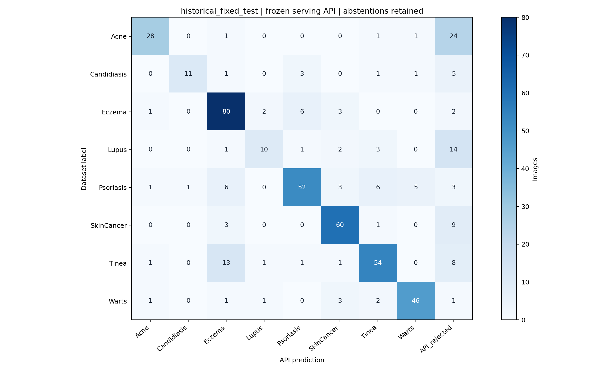
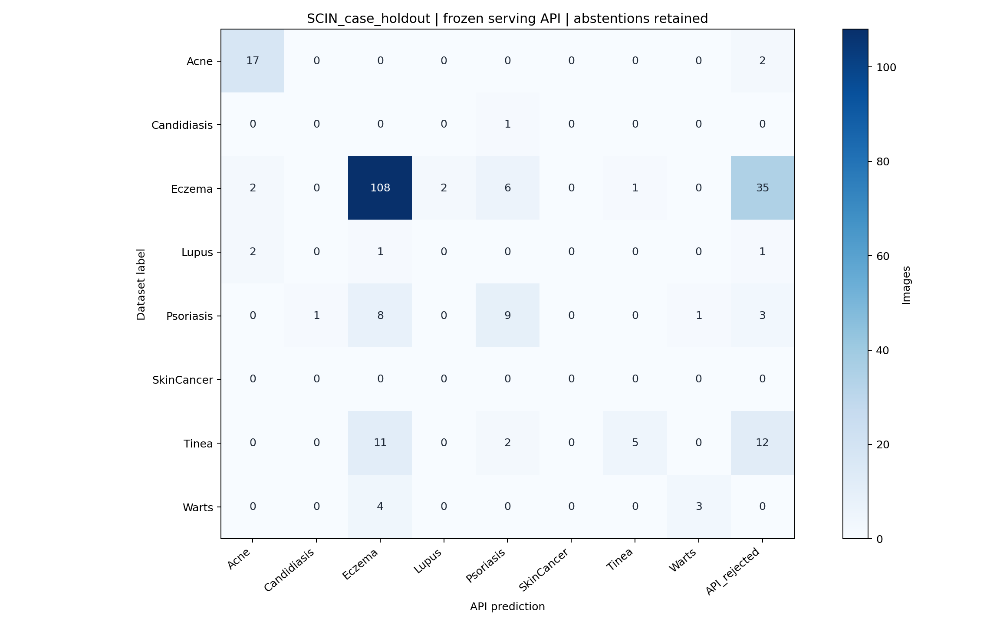

# Đánh giá đúng bản AI đã tích hợp vào đồ án

**Phiên bản:** `dermai-eight-esg-v1-20261108`. Dữ liệu và cấu hình được khóa trước khi chấm. Không huấn luyện lại, đổi ngưỡng hoặc chọn ảnh theo kết quả mới.

**Phạm vi:** đánh giá hồi cứu trên các tập test lịch sử đã được nghiên cứu trước đây. Đây là phép đo của bản phục vụ, nhưng chưa phải test mù mới hoặc đánh giá lâm sàng độc lập.

**Thử lại:** có 1 sự cố timeout HTTP 60 giây. Bảng chính dùng kết quả cuối sau khi khởi động lại service không đổi và gửi lại đúng ảnh; không bỏ ảnh đó. Đây không phải tỷ lệ thành công ngay yêu cầu đầu tiên. Xem bảng sự cố thực thi phía dưới.

## Bản nào được chấm?

Luồng thật `/predict`: kiểm tra file/chất lượng ảnh → OOD → 15 CNN thuộc năm cấu hình E/G/S → biểu quyết có bảo toàn SkinCancer → nhãn, điểm đồng thuận, cờ chưa chắc chắn, Grad-CAM và RAG. Mọi ảnh bị API từ chối vẫn được ghi lại. Các ảnh trả nhãn nhưng có cờ `uncertain` vẫn nằm trong mẫu tính chỉ số.

## Kết quả

| Tập dữ liệu | Tổng ảnh gửi | API trả nhãn | API từ chối | Tỷ lệ nhận ảnh | Độ đúng trên ảnh trả nhãn | Trả đúng / toàn bộ ảnh | Macro F1 tám lớp, tính cả ảnh từ chối |
|---|---:|---:|---:|---:|---:|---:|---:|
| Test lịch sử đã rà trùng | 486 | 420 | 66 | 86,42% | 81,19% | 70,16% | 71,15% |
| SCIN giữ lại đã rà trùng | 237 | 184 | 53 | 77,64% | 77,17% | 59,92% | 35,98% |

**Cách đọc:** “Độ đúng trên ảnh trả nhãn” chỉ tính những ảnh API nhận xử lý; luôn đọc kèm tỷ lệ nhận ảnh. “Trả đúng / toàn bộ ảnh” lấy số ảnh có nhãn dự đoán đúng chia cho toàn bộ ảnh được gửi trong tập đã rà; ảnh từ chối không được tính là đã trả đúng. Ảnh từ chối là yêu cầu chụp lại/ngoài phạm vi, không phải một chẩn đoán bệnh sai cụ thể.

Macro F1 toàn luồng dùng cố định tám nhãn; dự đoán từ chối nằm ở cột thứ chín của ma trận và làm giảm recall/F1 của lớp thật. Đây là chỉ số khác với Macro F1 chỉ tính trên ảnh được trả nhãn. Không được bỏ ảnh bị từ chối để làm điểm tổng cao hơn mà không báo coverage.

## Kết quả từng nguồn

### Test lịch sử đã rà trùng

Có 341/420 ảnh trả nhãn đúng; API nhận 420/486 ảnh. Số kết quả có cờ chưa chắc chắn: 71; không loại các kết quả này khỏi phép đo.

| Bệnh | Ảnh gửi | Trả nhãn | Nhận đúng | Từ chối | Precision | Recall trên toàn bộ ảnh của bệnh | F1 toàn luồng |
|---|---:|---:|---:|---:|---:|---:|---:|
| Acne | 55 | 31 | 28 | 24 | 87,50% | 50,91% | 64,37% |
| Candidiasis | 22 | 17 | 11 | 5 | 91,67% | 50,00% | 64,71% |
| Eczema | 94 | 92 | 80 | 2 | 75,47% | 85,11% | 80,00% |
| Lupus | 31 | 17 | 10 | 14 | 71,43% | 32,26% | 44,44% |
| Psoriasis | 77 | 74 | 52 | 3 | 82,54% | 67,53% | 74,29% |
| SkinCancer | 73 | 64 | 60 | 9 | 83,33% | 82,19% | 82,76% |
| Tinea | 79 | 71 | 54 | 8 | 79,41% | 68,35% | 73,47% |
| Warts | 55 | 54 | 46 | 1 | 86,79% | 83,64% | 85,19% |

Macro F1 trên ảnh được trả nhãn, giữ tám lớp: **79,74%**.

Khoảng 95% bootstrap theo nhóm proxy (1.000 lượt, seed 42):

| Chỉ số | Khoảng 95% |
|---|---|
| Tỷ lệ nhận ảnh | 83,54% – 89,44% |
| Độ đúng trên ảnh trả nhãn | 77,43% – 84,93% |
| Trả đúng / toàn bộ ảnh | 66,11% – 74,24% |
| Macro F1 tám lớp toàn luồng | 66,22% – 75,59% |

Nhóm SCIN dùng mã ca nguồn và liên kết dHash; nhóm ảnh nguồn cũ dựa vào dHash. Đây chưa phải ID bệnh nhân đã xác minh. Khoảng này không bao gồm bất định từ việc từng dùng dữ liệu để nghiên cứu nhiều phương pháp.

**Lý do API từ chối:**

- 48 ảnh: Ảnh quá nhỏ. Vui lòng dùng ảnh có mỗi chiều tối thiểu 224 px.
- 18 ảnh: Ảnh nằm ngoài phạm vi tám nhóm bệnh được hỗ trợ. Vui lòng chọn ảnh tổn thương da khác hoặc khám trực tiếp.

### SCIN giữ lại đã rà trùng

Có 142/184 ảnh trả nhãn đúng; API nhận 184/237 ảnh. Số kết quả có cờ chưa chắc chắn: 30; không loại các kết quả này khỏi phép đo.

| Bệnh | Ảnh gửi | Trả nhãn | Nhận đúng | Từ chối | Precision | Recall trên toàn bộ ảnh của bệnh | F1 toàn luồng |
|---|---:|---:|---:|---:|---:|---:|---:|
| Acne | 19 | 17 | 17 | 2 | 80,95% | 89,47% | 85,00% |
| Candidiasis | 1 | 1 | 0 | 0 | 0,00% | 0,00% | 0,00% |
| Eczema | 154 | 119 | 108 | 35 | 81,82% | 70,13% | 75,52% |
| Lupus | 4 | 3 | 0 | 1 | 0,00% | 0,00% | 0,00% |
| Psoriasis | 22 | 19 | 9 | 3 | 50,00% | 40,91% | 45,00% |
| SkinCancer | 0 | 0 | 0 | 0 | — | — | — |
| Tinea | 30 | 18 | 5 | 12 | 83,33% | 16,67% | 27,78% |
| Warts | 7 | 7 | 3 | 0 | 75,00% | 42,86% | 54,55% |

Macro F1 trên ảnh được trả nhãn, giữ tám lớp: **40,05%**.

Nguồn này không đủ tám bệnh. Không có ảnh SkinCancer nên Recall SkinCancer là **không xác định**, không phải 0%. Có 0 ảnh được API gán SkinCancer nhưng nhãn dataset thuộc nhóm khác; không diễn giải điều này thành kết luận mô bệnh học. Macro F1 trung bình trên các lớp có ảnh là 41,12%; không dùng nó để thay điểm đủ tám lớp. Lupus/Candidiasis có rất ít mẫu, chưa đủ để kết luận ổn định.

Khoảng 95% bootstrap theo nhóm proxy (1.000 lượt, seed 42):

| Chỉ số | Khoảng 95% |
|---|---|
| Tỷ lệ nhận ảnh | 71,31% – 83,74% |
| Độ đúng trên ảnh trả nhãn | 70,00% – 84,21% |
| Trả đúng / toàn bộ ảnh | 52,63% – 67,57% |
| Macro F1 tám lớp toàn luồng | 25,27% – 42,44% |

Nhóm SCIN dùng mã ca nguồn và liên kết dHash; nhóm ảnh nguồn cũ dựa vào dHash. Đây chưa phải ID bệnh nhân đã xác minh. Khoảng này không bao gồm bất định từ việc từng dùng dữ liệu để nghiên cứu nhiều phương pháp.

**Lý do API từ chối:**

- 46 ảnh: Ảnh bị mờ. Vui lòng giữ máy ổn định và lấy nét vào vùng da.
- 7 ảnh: Ảnh nằm ngoài phạm vi tám nhóm bệnh được hỗ trợ. Vui lòng chọn ảnh tổn thương da khác hoặc khám trực tiếp.

## Rà dữ liệu trước khi chấm

Đối chiếu 6155 ảnh thuộc các thư mục train tám lớp, bao phủ toàn bộ cohort 5.937 ảnh dùng cho CNN, inner validation, specialist và cổng. Phạm vi bảo vệ mở rộng này cũng giữ cả ảnh raw có thể đã bị loại khỏi các lượt train riêng; loại trùng là thận trọng, không có nghĩa mọi ảnh raw đều đã được model học.

| Nguồn | Ứng viên | Được giữ | Loại trước khi chấm |
|---|---:|---:|---:|
| Test lịch sử đã rà trùng | 569 | 486 | 83 |
| SCIN giữ lại đã rà trùng | 240 | 237 | 3 |

Kiểm tra SHA-256, pixel RGB, dHash khoảng cách ≤3, mã ca SCIN và các cặp cùng cảnh đã rà trước đó. Chỉ nhận các ảnh thuộc tập tham chiếu đã xử lý xung đột nhãn; kiểm tra trùng giữa các ứng viên. dHash có thể gắn cờ các ảnh chỉ giống nhau về hình thức; việc loại cờ trước chấm là bảo thủ và không xác nhận độc lập bệnh nhân. Nhãn là nhãn dataset/nguồn, chưa có bác sĩ của dự án xác nhận lại.

## Kiểm chứng và sự cố thực thi

Bốn unit test cho kiểm tra rò rỉ và cách tính khi có ảnh từ chối đạt. Đối chiếu thêm 100 bộ dữ liệu giả lập với sklearn đạt. Sau khi khóa toàn bộ dự đoán, kiểm tra lại từng dòng theo manifest; tính độc lập confusion matrix 8×9, độ đúng có điều kiện, tỷ lệ trả đúng và Macro F1 bằng sklearn. SHA của mã ứng dụng, dữ liệu và 26 tài sản model được giữ nguyên.

Lượt native Windows gặp access violation khi Pillow mã hóa ảnh PNG Grad-CAM. 225 kết quả dở đã được lưu riêng và **không đưa vào các chỉ số ở báo cáo này**. Trước khi chấm lại, khóa phụ lục đổi môi trường sang API Linux Docker. Toàn bộ danh sách ảnh được chạy lại từ đầu, cùng mã, checkpoint, ngưỡng và tiêu chí. Không sửa model để vượt qua lỗi; không bỏ mẫu gây lỗi.

Có 1 sự cố timeout trong lượt Docker. Ghi sự cố trước khi thử lại cùng ảnh, giữ nguyên prefix và toàn bộ checkpoint/cấu hình. Bảng chính mô tả phân loại sau khi thu được phản hồi cuối. Bảng phụ sau coi yêu cầu timeout là **chưa trả được nhãn ở lần đầu**, không dùng nhãn thành công sau retry để che lỗi vận hành.

| Nguồn | API trả nhãn ngay lần đầu | Độ đúng trên nhãn trả ngay lần đầu | Trả đúng / toàn bộ ảnh ở lần đầu |
|---|---:|---:|---:|
| Test lịch sử đã rà trùng | 419/486 | 81,15% | 69,96% |
| SCIN giữ lại đã rà trùng | 184/237 | 77,17% | 59,92% |

Chẩn đoán vận hành này được bổ sung sau sự cố và không dùng để chọn model. Lượt thử gọi trực tiếp AI API với timeout 60 giây; chưa phải kiểm thử toàn bộ giao diện/gateway hoặc cam kết độ trễ của ứng dụng.

## Được phép kết luận gì?

Đã có phép đo của đúng pipeline phục vụ trên các tập lịch sử sau rà trùng, bao gồm cả các cổng từ chối. Đây là đánh giá hồi cứu có giá trị kiểm tra ứng dụng, không phải kết quả test mù trên bệnh nhân mới.

Không so trực tiếp các tỷ lệ trong báo cáo này với OOF 78,95% / 77,73% / 88,04% rồi quy toàn bộ chênh lệch cho cách biểu quyết: tập dữ liệu, phân bố và việc có cổng chất lượng/OOD đều khác. Mốc OOF vẫn thuộc thí nghiệm cũ. Các chỉ số độc lập của bản phục vụ trong manifest vẫn để null, vì chưa có tập test độc lập mới.

Không gộp hai nguồn thành một điểm chính: nguồn SCIN không có SkinCancer và phân bố lớp khác. Không dùng kết quả này để chọn lại trọng số, ngưỡng, model hoặc các ảnh được báo cáo.

[Kết quả máy đọc](results.json) · [Kiểm chứng](verification.json) · [Môi trường thực thi](environment.json) · [Protocol cục bộ](protocol.json) · [Phụ lục đổi môi trường](execution_amendment.json)
