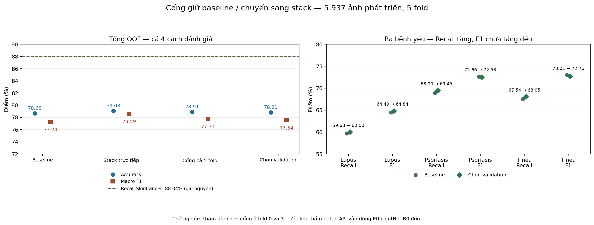
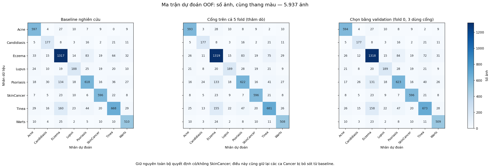

# Thử nghiệm cổng giữ baseline hoặc chuyển sang stack

**Ngày 23/10/2026 — đã hoàn tất huấn luyện các đầu logistic, kiểm chứng độc lập PASS.**

## 1. Kết quả dễ hiểu

Bản chọn bằng validation đạt **Accuracy 78.81% / Macro F1 77.54% / Recall SkinCancer 88.04%** trên 5.937 ảnh OOF phát triển. So với baseline nghiên cứu, tăng **+0.13 điểm % Accuracy** và **+0.31 điểm % Macro F1**, tức đoán đúng thêm **8 ảnh**. Toàn bộ quyết định có/không SkinCancer giữ nguyên.

**Đây là ứng viên thăm dò có cải thiện tổng, chưa chứng minh cải thiện ổn định ở mọi bệnh hoặc trên nguồn mới.** Recall Lupus/Psoriasis/Tinea đều tăng nhẹ nhưng F1 Psoriasis và Tinea giảm; Macro F1 của phần SCIN cũng giảm. Baseline tham chiếu được giữ nguyên; API và file Word chưa thay đổi.

## 2. Bảng tổng: phân biệt bản được chọn và đối chứng thăm dò

| Phương pháp | Accuracy % | Macro F1 % | Recall SkinCancer % | Đúng / 5.937 | Sửa đúng / làm sai / sai→sai |
| --- | --- | --- | --- | --- | --- |
| Baseline nghiên cứu | 78.6761 | 77.2377 | 88.0355 | 4671 | 0 / 0 / 0 |
| Stack trực tiếp (đối chứng) | 79.0803 | 78.5926 | 88.0355 | 4695 | 198 / 174 / 171 |
| Cổng trên cả 5 fold (thăm dò) | 78.9119 | 77.7129 | 88.0355 | 4685 | 36 / 22 / 32 |
| Chọn bằng validation (fold 0, 3 dùng cổng) | 78.8108 | 77.5450 | 88.0355 | 4679 | 24 / 16 / 25 |

“Chọn bằng validation” dùng cổng ở **fold 0 và 3**; fold 1, 2 và 4 giữ baseline. Đã khóa cả năm lựa chọn trước lần chấm outer. **Không chọn cổng trên cả năm fold bằng điểm outer cao hơn.** Stack trực tiếp là đối chứng đã có, được huấn luyện lại để kiểm tra tái lập, không phải backbone mới.

Bản được chọn đổi nhãn **65 ảnh**: sửa 24 lỗi, làm sai 16 ảnh đang đúng, và đổi từ một nhãn sai sang nhãn sai khác 25 ảnh. Các lần đổi sai→sai không đổi Accuracy nhưng vẫn có thể đổi precision và Macro F1.

## 3. Từng bệnh: baseline → bản chọn bằng validation

| Bệnh | Số ảnh | Precision cũ % | Precision mới % | Recall cũ % | Recall mới % | F1 cũ % | F1 mới % | Δ F1 (điểm %) |
| --- | --- | --- | --- | --- | --- | --- | --- | --- |
| Acne | 663 | 82.57 | 84.02 | 90.05 | 89.59 | 86.15 | 86.72 | +0.568 |
| Candidiasis | 243 | 67.82 | 70.80 | 72.84 | 72.84 | 70.24 | 71.81 | +1.567 |
| Eczema | 1577 | 76.88 | 77.17 | 83.51 | 83.58 | 80.06 | 80.24 | +0.183 |
| Lupus | 315 | 70.15 | 70.52 | 59.68 | 60.00 | 64.49 | 64.84 | +0.343 |
| Psoriasis | 897 | 76.87 | 75.88 | 68.90 | 69.45 | 72.66 | 72.53 | -0.137 |
| SkinCancer | 677 | 86.25 | 86.25 | 88.04 | 88.04 | 87.13 | 87.13 | +0.000 |
| Tinea | 989 | 79.43 | 78.16 | 67.54 | 68.05 | 73.01 | 72.76 | -0.249 |
| Warts | 576 | 80.19 | 80.67 | 88.54 | 88.37 | 84.16 | 84.34 | +0.183 |

Recall tăng nghĩa là nhận ra thêm ảnh mang nhãn bệnh; F1 cân bằng precision và recall. Vì số lần gán nhầm bệnh vẫn tăng, F1 Psoriasis/Tinea chưa tăng theo recall. Các điều kiện giữ điểm trên validation giúp sàng lọc ứng viên, **không bảo đảm** từng chỉ số outer cũng không giảm.

## 4. Theo nguồn ảnh có sẵn trong cohort phát triển

| Nguồn | Số ảnh | Phương pháp | Accuracy % | Macro F1 tám nhãn % |
| --- | --- | --- | --- | --- |
| original_train | 4961 | Baseline nghiên cứu | 80.29 | 79.31 |
| original_train | 4961 | Stack trực tiếp (đối chứng) | 80.83 | 80.40 |
| original_train | 4961 | Cổng trên cả 5 fold (thăm dò) | 80.49 | 79.65 |
| original_train | 4961 | Chọn bằng validation (fold 0, 3 dùng cổng) | 80.41 | 79.59 |
| SCIN | 976 | Baseline nghiên cứu | 70.49 | 30.71 |
| SCIN | 976 | Stack trực tiếp (đối chứng) | 70.18 | 31.56 |
| SCIN | 976 | Cổng trên cả 5 fold (thăm dò) | 70.90 | 31.08 |
| SCIN | 976 | Chọn bằng validation (fold 0, 3 dùng cổng) | 70.70 | 30.42 |

Tên `original_train` là nguồn dữ liệu lịch sử trong manifest; mỗi ảnh ở bảng này vẫn được chấm bằng outer model không train trên chính ảnh đó. SCIN có 976 ảnh, 645 là Eczema, chỉ 11 Lupus, 7 Candidiasis và **không có SkinCancer**. Macro F1 ở đây luôn lấy đủ tám nhãn và cho lớp vắng mặt điểm 0; không đọc Recall SkinCancer trên SCIN thành một phép kiểm tra cancer. Bản được chọn có Macro F1 SCIN **30.4167%**, so với baseline **30.7142%**. Lupus SCIN vẫn nhận đúng 0/11 ảnh. Đã kiểm tra thêm DermaCon/SkinDisNet có sẵn ở phụ lục mục 9; chưa có dữ liệu bệnh nhân mới.

## 5. Theo từng outer fold

| Fold | Số ảnh outer | Quyết định khóa bằng validation | Baseline Acc / MF % | Stack trực tiếp Acc / MF % | Cổng thăm dò Acc / MF % | Bản chọn Acc / MF % |
| --- | --- | --- | --- | --- | --- | --- |
| 0 | 1176 | Dùng cổng | 78.32 / 76.94 | 78.74 / 78.37 | 78.74 / 78.18 | 78.74 / 78.18 |
| 1 | 1193 | Giữ baseline | 77.62 / 76.55 | 77.95 / 76.60 | 77.54 / 76.40 | 77.62 / 76.55 |
| 2 | 1206 | Giữ baseline | 80.85 / 80.83 | 80.93 / 82.14 | 81.09 / 81.14 | 80.85 / 80.83 |
| 3 | 1201 | Dùng cổng | 77.85 / 75.33 | 78.27 / 77.14 | 78.10 / 75.72 | 78.10 / 75.72 |
| 4 | 1161 | Giữ baseline | 78.73 / 76.23 | 79.50 / 78.26 | 79.07 / 76.79 | 78.73 / 76.23 |

| Fold | Validation gốc | Lỗi điều kiện của cổng trên validation | Mẫu fit cổng cuối (làm sai / sửa đúng) | Ba cổng meta: số mẫu quyết định | Số fit stack / cổng |
| --- | --- | --- | --- | --- | --- |
| 0 | 718 | Không có | 48 (20 / 28) | 35 / 40 / 47 | 10 / 4 |
| 1 | 713 | Tinea_f1 | 34 (19 / 15) | 23 / 23 / 25 | 10 / 4 |
| 2 | 711 | Lupus_f1, Lupus_recall, Psoriasis_f1, Psoriasis_recall, accuracy, macro_f1, precision_Psoriasis | 58 (31 / 27) | 47 / 61 / 38 | 10 / 4 |
| 3 | 712 | Không có | 55 (30 / 25) | 33 / 28 / 41 | 10 / 4 |
| 4 | 716 | Lupus_f1, Psoriasis_f1, Tinea_f1, accuracy, macro_f1, precision_Lupus, precision_Psoriasis, precision_Tinea, recall_Candidiasis | 41 (25 / 16) | 31 / 28 / 33 | 10 / 4 |

Các tên lỗi như `Tinea_f1`, `Lupus_recall` nghĩa là chỉ số đó giảm so với baseline trên validation; `precision_*`, `recall_*` là vi phạm giới hạn precision/recall tương ứng. Cỡ mẫu học cổng khá nhỏ, nên kết quả giữa các fold dễ dao động.

## 6. Đã học thêm gì, và phòng rò rỉ ở tầng gộp ra sao?

1. **Không cập nhật CNN.** Giữ 15 checkpoint của ba kiến trúc cũ. Học lại stack logistic tám nhãn từ 24 log xác suất của B0/ConvNeXt/ResNet, chuẩn hóa bằng train của tầng gộp; L2, C=0,1, không cân bằng lớp.
2. **Học cổng bằng 22 đặc trưng có ở lúc dự đoán:** chênh log xác suất giữa nhãn stack và baseline từ ba model, chênh tương tự của stack, chênh số phiếu của ba model, entropy trung bình và hai vector one-hot nhãn baseline/stack. Không dùng nhãn thật, tên nguồn hoặc mã ca trong đầu vào dự đoán.
3. **Nhãn học cổng:** 1 khi stack sửa được lỗi baseline; 0 khi stack làm sai một ảnh baseline đang đúng. Ảnh hai bên cùng sai hoặc cùng nhãn bị loại khỏi phần fit cổng, nhưng vẫn được chấm lúc đánh giá. StandardScaler chỉ fit trên các ảnh quyết định này. Cổng cũng là logistic L2, C=0,1, không cân bằng lớp.
4. **Chỉ chuyển khi điểm cổng > 2/3**, baseline và stack khác nhau, cả hai đều không phải SkinCancer. Bằng ngưỡng thì giữ baseline; ngưỡng và đặc trưng được cố định trước huấn luyện, không quét thử trên outer. Điểm cổng là điểm học từ tập các lần sửa đúng/làm sai, **không phải xác suất mắc bệnh hay độ tin cậy lâm sàng đã hiệu chỉnh**.
5. **Mỗi outer CNN fold có ba phần meta validation theo nhóm.** Để chấm một phần meta, hai phần còn lại được chia thêm hai nhóm để tạo dự đoán stack ngoài mẫu cho việc học cổng; sau đó fit stack trên toàn hai phần và chấm phần meta đang giữ. Không dùng nhóm meta đang giữ để fit stack, cổng hoặc scaler tương ứng.
6. **Cổng cuối chỉ học từ dự đoán stack OOF trong toàn inner validation**, rồi stack cuối mới được fit trên toàn inner. Không lấy xác suất stack đã học chính ảnh đó để tạo nhãn học cổng cuối. Tổng cộng **50 lần fit stack và 20 lần fit cổng**; trong 50 có 20 fit tái tạo đối chứng stack cũ. Không thêm ảnh, không thêm backbone, không sửa nhãn.

Các checkpoint CNN và trọng số baseline đã được lựa chọn bằng inner validation trong lịch sử. Việc chia nhóm lồng nhau ở tầng gộp xử lý rò rỉ trực tiếp khi fit tầng gộp, **không xóa lịch sử sử dụng validation của các model cha** và không biến toàn bộ CNN thành thí nghiệm nested CV hoàn chỉnh.

## 7. Độ bất định và giới hạn

| Phương pháp so baseline | Khoảng 95% Δ Accuracy (điểm %) | Khoảng 95% Δ Macro F1 (điểm %) |
| --- | --- | --- |
| Stack trực tiếp (đối chứng) | -0.221 đến +1.043 | +0.582 đến +2.135 |
| Cổng trên cả 5 fold (thăm dò) | +0.000 đến +0.477 | +0.204 đến +0.752 |
| Chọn bằng validation (fold 0, 3 dùng cổng) | -0.067 đến +0.340 | +0.067 đến +0.551 |

Khoảng trên dùng 1.000 bootstrap cặp theo nhóm trên chính tập phát triển đã khảo sát. Khoảng Accuracy của bản được chọn còn chứa 0. Khoảng Macro F1 dương là kết quả có điều kiện trên các quyết định đã khóa, **chưa hiệu chỉnh cho nhiều lượt thử nghiệm đã làm**, chưa bao gồm dao động khi train lại CNN bằng seed khác. Các nhóm ảnh chưa phải mã bệnh nhân được xác nhận. Một seed CNN, ít mẫu quyết định để học cổng và khác biệt độ tự tin giữa stack fit trên phần nhỏ với stack cuối là các giới hạn còn lại.

Nguồn ảnh đã được nghiên cứu nhiều lần, không phải test lâm sàng độc lập mới. Giữ nguyên mặt nạ SkinCancer cũng giữ nguyên 596/677 ảnh cancer nhận đúng và 81 ảnh bị bỏ sót của baseline; không phải đã khắc phục lỗi cancer. Kết quả này hỗ trợ tiếp tục đánh giá ứng viên, chưa đủ để tuyên bố mô hình dùng tốt cho bệnh nhân.

## 8. Kiểm chứng và tài liệu

- Kiểm chứng độc lập **PASS**: refit đủ 70 mô hình, sai số tham số tối đa 0.0; tính lại 47 bộ chỉ số; kiểm tra đủ 5 lựa chọn, ranh giới nhóm, scaler, đầu vào SHA-256, tái tạo stack cũ và toàn bộ mặt nạ Cancer.
- Bộ kiểm thử dự án: **171/171 PASS trong 17,52 giây**. Đây là kiểm chứng kỹ thuật, không phải bác sĩ rà ảnh hay xác nhận độ chính xác lâm sàng.
- Baseline nghiên cứu tham chiếu vẫn 78,6761% Accuracy / 77,2377% Macro F1 / 88,0355% Recall SkinCancer. Ứng viên mới được ghi riêng để so sánh; API vẫn phục vụ EfficientNet-B0 đơn, không phải ứng viên hoặc ensemble nghiên cứu.
- [Protocol đã khóa](protocol.json), [kết quả đầy đủ](results.json), [khóa cả năm fold](all_selections_locked.json), [dự đoán từng ảnh](oof_decisions.json), [kiểm chứng độc lập](independent_review.json).
- Mượn ý tưởng cổng chọn chuyên gia từ [Jacobs và cộng sự, 1991](https://www.cs.toronto.edu/~hinton/absps/jjnh91.pdf); không tái lập kiến trúc mixture of experts được huấn luyện chung của bài báo.
- Tham khảo nguyên tắc dùng dự đoán cross-validation để học tầng gộp từ [tài liệu StackingClassifier, scikit-learn 1.3](https://scikit-learn.org/1.3/modules/generated/sklearn.ensemble.StackingClassifier.html). Mã hiện tại tự thực hiện chia nhóm lồng nhau; không gọi trực tiếp StackingClassifier.

## 9. Phụ lục: kiểm tra chuyển nguồn bằng lựa chọn đã khóa

Đã chấm thêm **1.709 ảnh có sẵn**: 986 DermaCon và 723 SkinDisNet, dùng cache xác suất của 15 CNN cũ. **Không fit thêm, không chỉnh ngưỡng, không chọn lại cổng theo nguồn.** Vẫn dùng cổng ở fold 0/3 và baseline ở fold 1/2/4.

Mỗi bộ ảnh được chấm bởi cùng **năm hệ thống theo fold**; bảng là **trung bình cộng chỉ số của năm hệ thống trên cùng các ảnh**. Đây không phải năm fold nguồn mới, năm seed độc lập hay một classifier mới gộp xác suất năm fold. Không nhân 1.709 lên năm để đếm số ảnh độc lập, và không so trực tiếp trung bình này với điểm của riêng fold 0 ở pilot trước.

| Nguồn / vai trò | Số ảnh | Số nhãn có ảnh | Accuracy cũ → mới % | Macro F1 đủ tám nhãn cũ → mới % | Macro F1 chỉ nhãn có ảnh cũ → mới % |
| --- | --- | --- | --- | --- | --- |
| DermaCon: toàn bộ (gồm ba vai trò dưới) | 986 | 8 | 39.03 → 38.82 | 34.16 → 34.10 | 34.16 → 34.10 |
| DermaCon: train phụ lịch sử | 590 | 8 | 37.32 → 37.05 | 30.00 → 29.81 | 30.00 → 29.81 |
| DermaCon: validation lịch sử | 213 | 8 | 44.32 → 44.32 | 41.79 → 41.92 | 41.79 → 41.92 |
| DermaCon: official test lịch sử | 183 | 7 | 38.36 → 38.14 | 32.07 → 31.95 | 36.65 → 36.51 |
| SkinDisNet: chỉ Eczema / Tinea | 723 | 2 | 22.30 → 22.57 | 6.91 → 7.04 | 27.64 → 28.14 |

Kết quả **chưa cải thiện nhất quán khi đổi nguồn**: DermaCon toàn bộ và official test đều giảm nhẹ; SkinDisNet tăng nhẹ. Official test 183 ảnh không có Lupus, chỉ có 6 SkinCancer; SkinDisNet chỉ có Eczema/Tinea, không kiểm tra được sáu bệnh còn lại. Macro F1 đủ tám nhãn cho lớp không có ảnh điểm 0; cột cuối chỉ lấy các nhãn có ảnh, không phải nhiệm vụ hai nhãn được train lại.

Cả hai nguồn đã được khảo sát trong lịch sử; 590 ảnh mang vai trò train phụ từng dùng cho các pilot khác, 213 validation và 183 official test cũng đã được xem xét trước. Các vai trò được giữ riêng trong bảng; không cộng lại với hàng DermaCon toàn bộ. Đây **không phải kiểm tra lâm sàng độc lập mới**. Mặt nạ SkinCancer được giữ nguyên so với baseline tương ứng ở từng nguồn, không có nghĩa recall trên nguồn khác cũng bằng 88,04%. Không tính khoảng tin cậy mới cho phần phụ lục và không tuyên bố khác biệt có ý nghĩa thống kê.

Kiểm chứng nguồn độc lập **PASS**: tính lại 100 bộ chỉ số, tái tạo 8,545 lượt dự đoán trên 1.709 ảnh duy nhất (mỗi ảnh qua năm hệ thống), sai số điểm cổng tối đa 2.22e-16; đã kiểm tra SHA đầu vào, lựa chọn khóa và mặt nạ Cancer. Đây là kiểm chứng phép tính trên dữ liệu có sẵn.

[Protocol phụ lục](transfer_check/protocol.json) · [kết quả nguồn đầy đủ theo từng fold và bệnh](transfer_check/results.json) · [biên bản kiểm chứng độc lập](transfer_check/independent_review.json).

**Kết luận:** Có cải thiện tổng nhỏ bằng một cổng đã chọn trước outer; vẫn cần chứng minh độ ổn định theo bệnh và theo nguồn. Không lấy điểm thăm dò cao hơn để thay thế quy tắc lựa chọn đã khóa.
