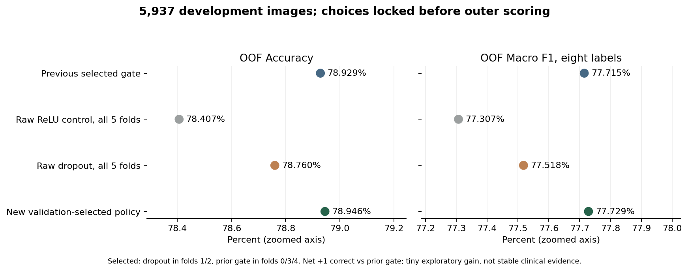
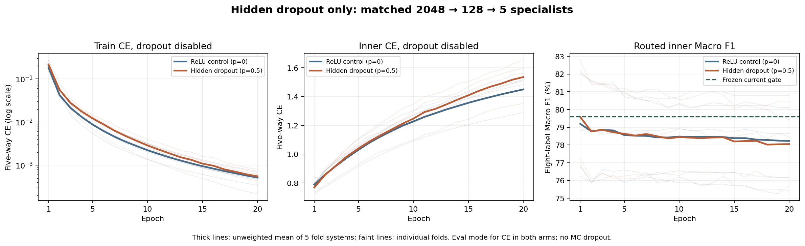

# Dropout cho đầu chuyên biệt: đối chứng đủ năm fold

Khởi chạy ngày 23/10/2026, hoàn tất báo cáo ngày 24/10/2026. Tiếp hướng của thầy: cải thiện Lupus, Psoriasis và Tinea, giữ SkinCancer. Thử nghiệm này chỉ thêm Dropout vào đầu ReLU đã có dấu hiệu quá khớp train.

## 1. Kết quả chính

**Bản chọn bằng validation đúng thêm một ảnh so cổng Macro F1 hiện có: 4.687/5.937 ảnh, Accuracy 78,95%, Macro F1 77,73%. Recall SkinCancer giữ 88,04%. Mức tăng rất nhỏ, chưa có bằng chứng cải thiện ổn định.**

| Phương án trên cùng 5.937 ảnh OOF | Accuracy | Macro F1 | Ảnh đúng | Sửa / làm sai / đổi sai→sai so cổng hiện có |
|---|---:|---:|---:|---:|
| Bộ gộp tham chiếu ban đầu | 78,68% | 77,24% | 4.671 | 12 / 27 / 27 |
| Cổng Macro F1 hiện có | 78,93% | 77,72% | 4.686 | 0 / 0 / 0 |
| Gắn đầu ReLU đối chứng ở mọi fold, p=0 | 78,41% | 77,31% | 4.655 | 54 / 85 / 26 |
| Gắn đầu Dropout ở mọi fold, p=0,5 | 78,76% | 77,52% | 4.676 | 28 / 38 / 14 |
| **Chọn bằng validation: Dropout fold 1/2, cổng cũ fold 0/3/4** | **78,95%** | **77,73%** | **4.687** | **11 / 10 / 3** |

Đầu Dropout ở cả năm fold tốt hơn đối chứng 21 ảnh, nhưng vẫn thấp hơn cổng hiện có 10 ảnh. Chính sách chọn trước outer chỉ đúng thêm một ảnh: **+0,01684 điểm phần trăm Accuracy và +0,01370 điểm phần trăm Macro F1**. Không đổi lựa chọn sau khi biết outer; đặc biệt fold 1 vẫn dùng Dropout dù outer của fold này giảm một ảnh.

Mốc tham chiếu 78,68%/77,24% được giữ để đối chiếu lịch sử. Kết quả mới là ứng viên nghiên cứu; API vẫn dùng EfficientNet-B0 đơn.

## 2. Chỉ thay điều gì?

- ResNet50 cố định, lấy 2.048 đặc trưng ảnh từ cache đã kiểm chứng của đúng fold. Không train CNN mới, không thêm backbone hoặc ảnh.
- Đầu năm nhóm nội bộ **Lupus/Psoriasis/Tinea/Eczema/Khác**, kiến trúc 2048→128→ReLU→Dropout→5, **262.917 tham số**. Cả hai nhánh có cùng tensor khởi tạo, output khởi tạo bằng 0; nhánh đối chứng p=0 và nhánh thử p=0,5.
- Cùng train gốc, scaler chỉ fit train, mỗi ảnh một lần/epoch. Cùng CE năm nhóm không trọng số, AdamW, batch 64, LR 0,0003, weight decay 0,001, clip gradient 2, **20 epoch mỗi đầu**.
- **10 đầu, 12.680 cập nhật và 200 lượt đánh giá checkpoint**. Đối chứng tái lập chính xác đầu ReLU lượt trước; không phải thêm seed CNN.
- RNG Dropout riêng theo fold, khởi tạo một lần cho toàn lượt train và tiến qua các batch/epoch. Generator lấy thứ tự ảnh độc lập, hai nhánh có cùng batch; khôi phục RNG toàn cục khi thoát.
- Chấm train/inner/outer bằng `eval()`: Dropout tắt, không MC Dropout. Inverted dropout đã nhân hệ số khi train, không nhân lại trọng số lúc dự đoán.

Ý tưởng ngẫu nhiên bỏ đơn vị khi train nhằm giảm sự phụ thuộc giữa các đơn vị tham khảo [Srivastava và cộng sự, JMLR 2014](https://jmlr.org/papers/v15/srivastava14a.html). Cách triển khai theo [PyTorch Dropout](https://docs.pytorch.org/docs/stable/generated/torch.nn.Dropout.html). Đây là phép đối chứng cục bộ của đề tài, không tái lập toàn bài báo hoặc bảo đảm tăng điểm trên ảnh da.

## 3. Chọn checkpoint và năm quyết định trước outer

Giữ cổng chuyên biệt **điểm ≥0,8**. Chỉ dự đoán hiện thuộc Lupus/Psoriasis/Tinea/Eczema mới có thể đổi; Khác hoặc điểm thấp thì giữ cổng hiện có. Mặt nạ SkinCancer giữ nguyên từng ảnh, gồm cả lỗi Cancer cũ.

Checkpoint ưu tiên đạt điều kiện validation, rồi Macro F1 tám nhãn, F1 trung bình ba bệnh yếu, Accuracy; hòa lấy epoch sớm. Điều kiện giữ nguyên: Accuracy/Macro F1 không giảm, Recall/F1 từng bệnh yếu không giảm, precision từng bệnh yếu giảm không quá hai điểm, recall các bệnh khác giảm không quá hai điểm, Cancer giữ nguyên. Dropout còn cần Macro F1 ≥ đối chứng và F1 trung bình ba bệnh yếu **cao hơn** đối chứng. Xếp hạng phương án theo Macro F1, recall trung bình nhóm yếu, Accuracy; hòa giữ cổng hiện có rồi đối chứng.

Mỗi ô validation dưới đây là **Accuracy / Macro F1 (%)**, được tính sau định tuyến đủ tám nhãn.

| Fold | Cổng hiện có | ReLU p=0 | Dropout p=0,5 | Quyết định đã khóa |
|---|---:|---:|---:|---|
| 0 | 77,7159 / 76,8157 | 77,7159 / 76,8344 | 77,7159 / 76,8344 | Giữ cổng: Dropout giảm Recall Psoriasis/Tinea, F1 Tinea; không hơn F1 yếu trung bình của đối chứng. |
| 1 | 81,9074 / 82,0558 | 81,7672 / 82,0998 | 81,9074 / 82,2006 | Chọn Dropout, đạt đủ điều kiện. |
| 2 | 76,7932 / 76,5711 | 77,3558 / 76,6444 | 77,6371 / 77,2320 | Chọn Dropout, đạt đủ điều kiện. |
| 3 | 79,7753 / 78,8860 | 79,6348 / 78,9141 | 79,9157 / 78,9423 | Giữ cổng: Dropout giảm Recall/F1 Psoriasis, không hơn F1 yếu trung bình đối chứng. |
| 4 | 83,2402 / 83,6760 | 81,5642 / 81,9629 | 82,1229 / 82,7899 | Giữ cổng: giảm nhiều chỉ số từng bệnh yếu, Accuracy/Macro F1 và precision Tinea. |

[Năm lựa chọn và SHA đã khóa](all_selections_locked.json) được lưu trước lần chấm outer này. Điểm tổng tốt không thay thế các điều kiện từng bệnh. Ngược lại, đạt điều kiện validation không bảo đảm chỉ số tương ứng trên outer cũng giữ được.

## 4. Kết quả từng fold outer

Mỗi ô là **Accuracy / Macro F1 (%)**. Mỗi ảnh outer chỉ được chấm bằng model của đúng fold.

| Fold | Ảnh outer | Cổng hiện có | ReLU p=0 | Dropout p=0,5 | Bản chọn bằng validation |
|---|---:|---:|---:|---:|---:|
| 0 | 1.176 | 78,91 / 78,21 | 79,25 / 78,51 | 79,25 / 78,47 | 78,91 / 78,21 |
| 1 | 1.193 | 77,62 / 76,55 | 77,37 / 76,41 | 77,54 / 76,53 | 77,54 / 76,53 |
| 2 | 1.206 | 80,85 / 80,83 | 80,35 / 80,51 | 81,01 / 80,93 | 81,01 / 80,93 |
| 3 | 1.201 | 78,52 / 76,53 | 77,02 / 75,28 | 77,60 / 75,59 | 78,52 / 76,53 |
| 4 | 1.161 | 78,73 / 76,23 | 78,04 / 75,65 | 78,38 / 75,86 | 78,73 / 76,23 |

## 5. Từng bệnh: có ổn hơn đồng đều không?

**Chưa.** Mỗi ô của bảng nhóm yếu ghi **Recall / F1 (%)**.

| Bệnh | Cổng hiện có | ReLU p=0 | Dropout mọi fold | Bản chọn bằng validation |
|---|---:|---:|---:|---:|
| Lupus | 61,27 / 65,20 | 59,37 / 64,48 | 60,00 / 64,51 | **61,27 / 65,31** |
| Psoriasis | 69,57 / 72,64 | 67,78 / 71,19 | 68,00 / 71,81 | **69,01 / 72,52** |
| Tinea | 67,95 / 72,81 | 68,66 / 72,66 | 68,15 / 72,98 | **67,95 / 72,92** |

Bản chọn giữ số Lupus/Tinea nhận đúng, tăng nhẹ precision/F1 của hai bệnh này. Psoriasis giảm **5 ảnh đúng, 624→619**, Recall giảm **0,56 điểm** và F1 giảm **0,12 điểm**. Eczema nhận thêm sáu ảnh, 1.321→1.327, bù phần giảm Psoriasis để tổng đúng thêm một ảnh. Không gọi đây là cải thiện đồng đều ba bệnh yếu.

Từng ô tiếp theo là **Precision / Recall / F1 (%)**.

| Bệnh | Số ảnh | Cổng hiện có | Bản chọn bằng validation |
|---|---:|---:|---:|
| Acne | 663 | 84,74 / 89,59 / 87,10 | 84,74 / 89,59 / 87,10 |
| Candidiasis | 243 | 71,37 / 72,84 / 72,10 | 71,37 / 72,84 / 72,10 |
| Eczema | 1.577 | 77,16 / 83,77 / 80,33 | 76,84 / 84,15 / 80,33 |
| Lupus | 315 | 69,68 / 61,27 / 65,20 | 69,93 / 61,27 / 65,31 |
| Psoriasis | 897 | 76,00 / 69,57 / 72,64 | 76,42 / 69,01 / 72,52 |
| SkinCancer | 677 | 86,25 / 88,04 / 87,13 | 86,25 / 88,04 / 87,13 |
| Tinea | 989 | 78,41 / 67,95 / 72,81 | 78,69 / 67,95 / 72,92 |
| Warts | 576 | 80,79 / 88,37 / 84,41 | 80,79 / 88,37 / 84,41 |

SkinCancer vẫn 596/677 ảnh đúng, còn 81 ảnh bị bỏ sót. Giữ mặt nạ bảo toàn chỉ số cũ, không tăng khả năng nhận Cancer hoặc chứng minh an toàn lâm sàng.

## 6. Dropout có giảm quá khớp không?

Các bảng dưới là **chẩn đoán năm nhóm của riêng đầu phụ**, không phải Accuracy tám bệnh của toàn bộ hệ thống. CE, Accuracy và confidence đều chấm lại bằng `eval()` trên train/inner; confidence là trung bình điểm lớn nhất của năm nhóm, chưa hiệu chỉnh. Loss ngẫu nhiên khi train có Dropout nằm riêng trong log `stochastic_train_loss`, không dùng so trực tiếp với loss train đối chứng.

### Checkpoint tốt nhất đã chọn bằng chỉ số tám bệnh

| Fold / đầu | Epoch | CE train / inner | Accuracy train / inner (%) | Confidence train / inner (%) |
|---|---:|---:|---:|---:|
| 0 / p=0 | 1 | 0,16350 / 0,79927 | 97,77 / 73,12 | 88,80 / 78,63 |
| 0 / p=0,5 | 1 | 0,20872 / 0,79932 | 96,22 / 72,84 | 85,93 / 76,02 |
| 1 / p=0 | 1 | 0,27390 / 0,83598 | 94,94 / 76,16 | 82,84 / 76,63 |
| 1 / p=0,5 | 1 | 0,27007 / 0,78168 | 92,71 / 76,02 | 82,55 / 75,03 |
| 2 / p=0 | 3 | 0,01502 / 0,96771 | 99,90 / 76,37 | 98,71 / 90,99 |
| 2 / p=0,5 | 1 | 0,20058 / 0,77060 | 93,91 / 73,42 | 86,78 / 77,68 |
| 3 / p=0 | 9 | 0,00266 / 1,23714 | 100,00 / 76,54 | 99,75 / 93,98 |
| 3 / p=0,5 | 2 | 0,05295 / 0,88316 | 98,81 / 75,84 | 96,70 / 88,30 |
| 4 / p=0 | 1 | 0,17129 / 0,73762 | 97,83 / 75,14 | 88,96 / 80,87 |
| 4 / p=0,5 | 1 | 0,18697 / 0,72418 | 97,51 / 75,14 | 87,50 / 78,70 |

### Epoch 20: vẫn quá khớp

| Fold / đầu | CE train / inner | Accuracy train / inner (%) | Confidence train / inner (%) |
|---|---:|---:|---:|
| 0 / p=0 | 0,00056 / 1,48515 | 100,00 / 75,07 | 99,95 / 95,30 |
| 0 / p=0,5 | 0,00069 / 1,56029 | 99,98 / 75,49 | 99,94 / 95,39 |
| 1 / p=0 | 0,00072 / 1,44892 | 100,00 / 78,40 | 99,93 / 94,99 |
| 1 / p=0,5 | 0,00081 / 1,51632 | 99,98 / 78,40 | 99,93 / 95,40 |
| 2 / p=0 | 0,00034 / 1,51751 | 100,00 / 75,81 | 99,97 / 95,30 |
| 2 / p=0,5 | 0,00022 / 1,65375 | 100,00 / 76,09 | 99,98 / 95,79 |
| 3 / p=0 | 0,00048 / 1,50762 | 100,00 / 76,54 | 99,95 / 95,35 |
| 3 / p=0,5 | 0,00061 / 1,59500 | 100,00 / 76,12 | 99,95 / 95,76 |
| 4 / p=0 | 0,00047 / 1,28858 | 100,00 / 77,79 | 99,95 / 95,26 |
| 4 / p=0,5 | 0,00043 / 1,35108 | 100,00 / 77,79 | 99,96 / 95,66 |

Dropout có thể thay checkpoint tốt nhất và số lần định tuyến. Tuy nhiên ở epoch 20, cả năm đầu Dropout vẫn gần 100% train Accuracy, CE inner cao hơn epoch 1 và cao hơn đối chứng cùng fold. **Cấu hình Dropout này chưa giải quyết quá khớp**; chưa có cơ sở kéo dài nguyên cấu hình để ép điểm tăng. Kết luận chỉ áp dụng đầu phụ đang thử, không suy ra mọi CNN gốc học vẹt hoặc mọi phương pháp Dropout đều không hiệu quả.

## 7. Định tuyến ở cùng ngưỡng 0,8

| Nhóm loại trừ nhau trên 5.937 ảnh | ReLU p=0 | Dropout p=0,5 |
|---|---:|---:|
| Dự đoán hiện ngoài phạm vi bốn bệnh | 2.270 | 2.270 |
| Trong phạm vi nhưng đầu chọn Khác | 245 | 276 |
| Đề xuất cùng nhãn hiện có | 2.937 | 2.894 |
| Đề xuất đổi bệnh nhưng điểm <0,8 | 320 | 417 |
| Chấp nhận đổi bệnh, điểm ≥0,8 | 165 | 80 |

Dropout giảm số lần đổi từ 165 xuống 80: sửa lỗi giảm 54→28, làm sai ảnh vốn đúng giảm 85→38. Đây là thay đổi độ phủ ở ngưỡng cố định, không chứng minh đầu ra đã được hiệu chỉnh. Không hạ ngưỡng hoặc quét p sau khi đọc kết quả. Bản chọn theo validation đổi 24 ảnh, gồm sửa 11/làm sai 10/đổi sai→sai 3.

## 8. Nguồn cũ và SCIN trong cùng OOF

Mỗi ô là **Accuracy / Macro F1 (%)**, Macro F1 luôn tính đủ tám nhãn, kể cả lớp không có ảnh thật ở một nguồn.

| Nguồn | Ảnh | Cổng hiện có | ReLU p=0 | Dropout mọi fold | Bản chọn bằng validation |
|---|---:|---:|---:|---:|---:|
| Nguồn cũ | 4.961 | 80,51 / 79,75 | 79,96 / 79,27 | 80,27 / 79,48 | 80,47 / 79,72 |
| SCIN | 976 | 70,90 / 30,61 | 70,49 / 30,64 | 71,11 / 30,60 | 71,21 / 30,65 |

Bản chọn giảm hai ảnh đúng nguồn cũ nhưng tăng ba ảnh đúng SCIN. SCIN Lupus vẫn **0/11**, chỉ sáu mã ca nguồn: chưa đủ bằng chứng xác định riêng nguyên nhân do nhãn, cách chụp hay mô hình. SCIN Psoriasis Recall **34,58→33,64%** (37→36/107), F1 **40,2174→40,2235%** gần như không đổi; Tinea Recall giữ **14,56%** (15/103), F1 **20,27→20,41%**. Không tự đổi nhãn hoặc bỏ ảnh khó để nâng điểm.

## 9. Độ bất định

Bootstrap ghép cặp 1.000 lần theo nhóm ca/cảnh, chênh so **cổng Macro F1 hiện có**, đơn vị điểm phần trăm:

| Phương án | Khoảng 95% Δ Accuracy | Khoảng 95% Δ Macro F1 |
|---|---:|---:|
| ReLU p=0 | [−0,9045; −0,1168] | [−0,7339; −0,0625] |
| Dropout ở mọi fold | [−0,4350; +0,1014] | [−0,4147; +0,0124] |
| Chọn bằng validation | **[−0,1347; +0,1679]** | **[−0,0883; +0,1137]** |

Khoảng của bản chọn chứa 0, phù hợp nhận định tăng một ảnh còn quá nhỏ. Các khoảng có điều kiện trên dữ liệu phát triển đã được xem nhiều lần, chưa tính đầy đủ việc tìm nhiều phương án, bất định seed CNN hoặc bệnh nhân chưa xác minh ID. Năm fold không phải năm seed; chưa phải test bệnh nhân mới độc lập.

## 10. Kiểm tra nguồn khác: đã chấm đúng chính sách mới

Đã chấm **1.709 ảnh duy nhất từ các nguồn đã biết**: DermaCon 986 ảnh và SkinDisNet 723 ảnh. DermaCon được tách theo vai trò lịch sử 590 train phụ + 213 validation + 183 official test; ba tập con cộng thành 986, không cộng thêm lần nữa. 590 ảnh từng dùng train các pilot khác; các CNN/đầu đang chấm trong lượt này không train những ảnh nguồn này. Các nguồn đã được khảo sát trước, thiếu xác minh ID bệnh nhân giữa nguồn; đây không phải bộ test bệnh nhân mới độc lập.

Mỗi ảnh được chấm bởi **cùng năm hệ thống theo fold đã khóa**, rồi lấy trung bình năm bộ chỉ số. Không gộp năm đầu ra thành một classifier, không tạo năm fold nguồn mới, không phải năm seed hoặc 8.545 ảnh duy nhất. Bản chọn mới dùng Dropout ở fold 1/2 và cổng hiện có ở fold 0/3/4; điểm được tính lại trực tiếp, không kế thừa điểm của cổng cũ.

Mỗi ô là **Accuracy / Macro F1 (%)**, trung bình qua năm hệ thống. Macro F1 ở bảng chính luôn có đủ tám nhãn.

| Nguồn và vai trò | Ảnh duy nhất | Gộp ban đầu | Cổng hiện có | ReLU p=0 | Dropout mọi fold | Bản chọn mới |
|---|---:|---:|---:|---:|---:|---:|
| DermaCon toàn nguồn | 986 | 39,03 / 34,16 | 38,74 / 33,89 | 39,25 / 34,41 | 38,86 / 34,05 | 38,72 / 33,93 |
| DermaCon train phụ lịch sử | 590 | 37,32 / 30,00 | 36,88 / 29,61 | 37,73 / 30,25 | 36,98 / 29,76 | 36,81 / 29,63 |
| DermaCon validation lịch sử | 213 | 44,32 / 41,79 | 44,32 / 41,74 | 44,98 / 42,31 | 44,98 / 42,27 | 44,51 / 41,88 |
| DermaCon official test lịch sử | 183 | 38,36 / 32,07 | 38,25 / 31,90 | 37,49 / 31,71 | 37,81 / 31,71 | 38,14 / 31,86 |
| SkinDisNet: Eczema/Tinea | 723 | 22,30 / 6,91 | 22,66 / 7,07 | 22,21 / 7,09 | 22,30 / 6,97 | 22,52 / 7,02 |

**Khả năng chuyển nguồn chưa cải thiện đồng đều.** So cổng hiện có, bản chọn mới giảm Accuracy nhưng tăng nhẹ Macro F1 trên toàn DermaCon; trên official test 183 ảnh và SkinDisNet thì cả hai đều giảm. Trên 183 ảnh official test không có Lupus, chỉ sáu ảnh SkinCancer; Macro F1 theo bảy lớp có ảnh thật là **36,42%**, so **36,45%** của cổng hiện có. SkinDisNet chỉ có Eczema/Tinea: Macro F1 theo hai lớp có ảnh thật **28,09%**, so **28,28%**; không dùng 7,02% Macro F1 tám nhãn để mô tả khả năng đủ tám bệnh trên nguồn này. Bản gộp ban đầu cũng được giữ trong bảng để thấy các lượt chỉnh không đồng thời thắng mọi nguồn.

### Ba bệnh yếu theo nguồn

Mỗi ô là **Precision / Recall / F1 (%)**, trung bình chỉ số qua cùng năm hệ thống; không tính P/R/F1 bằng cách lấy trung bình ma trận rồi tính lại. “Không có ảnh thật” nghĩa là nguồn không đánh giá được recall bệnh đó; không diễn giải số 0 của lớp vắng là kết quả nhận bệnh.

| Nguồn | Bệnh và số ảnh | Cổng hiện có | ReLU p=0 | Dropout mọi fold | Bản chọn mới |
|---|---|---:|---:|---:|---:|
| DermaCon toàn nguồn | Lupus, n=11 | 7,96 / 16,36 / 10,51 | 9,22 / 16,36 / 11,55 | 8,39 / 16,36 / 10,85 | 8,15 / 16,36 / 10,62 |
| DermaCon toàn nguồn | Psoriasis, n=154 | 35,49 / 73,38 / 47,50 | 36,07 / 70,26 / 47,36 | 35,55 / 70,91 / 47,03 | 35,51 / 72,34 / 47,34 |
| DermaCon toàn nguồn | Tinea, n=319 | 35,72 / 8,40 / 13,42 | 37,56 / 9,66 / 15,14 | 36,75 / 8,59 / 13,74 | 36,31 / 8,53 / 13,63 |
| DermaCon train phụ lịch sử | Lupus, n=6 | 7,35 / 16,67 / 9,97 | 8,44 / 16,67 / 10,93 | 7,94 / 16,67 / 10,44 | 7,71 / 16,67 / 10,19 |
| DermaCon train phụ lịch sử | Psoriasis, n=92 | 35,44 / 73,04 / 47,32 | 36,04 / 70,22 / 47,24 | 35,33 / 70,43 / 46,66 | 35,38 / 71,74 / 47,01 |
| DermaCon train phụ lịch sử | Tinea, n=200 | 36,29 / 8,80 / 13,91 | 38,50 / 10,00 / 15,56 | 37,61 / 9,00 / 14,28 | 37,40 / 9,00 / 14,24 |
| DermaCon validation lịch sử | Lupus, n=5 | 15,86 / 16,00 / 15,78 | 17,52 / 16,00 / 16,33 | 17,52 / 16,00 / 16,33 | 15,86 / 16,00 / 15,78 |
| DermaCon validation lịch sử | Psoriasis, n=29 | 35,96 / 77,24 / 48,71 | 36,56 / 75,17 / 48,76 | 36,16 / 74,48 / 48,29 | 36,11 / 76,55 / 48,74 |
| DermaCon validation lịch sử | Tinea, n=69 | 20,53 / 4,64 / 7,50 | 29,07 / 6,96 / 11,04 | 26,35 / 6,09 / 9,74 | 22,83 / 4,93 / 8,02 |
| DermaCon official test lịch sử | Lupus, n=0 | Không có ảnh thật | Không có ảnh thật | Không có ảnh thật | Không có ảnh thật |
| DermaCon official test lịch sử | Psoriasis, n=33 | 35,39 / 70,91 / 46,97 | 36,07 / 66,06 / 46,53 | 35,87 / 69,09 / 46,99 | 35,57 / 70,30 / 47,04 |
| DermaCon official test lịch sử | Tinea, n=50 | 50,35 / 12,00 / 19,21 | 42,69 / 12,00 / 18,61 | 45,17 / 10,40 / 16,85 | 46,74 / 11,60 / 18,48 |
| SkinDisNet: Eczema/Tinea | Lupus, n=0 | Không có ảnh thật | Không có ảnh thật | Không có ảnh thật | Không có ảnh thật |
| SkinDisNet: Eczema/Tinea | Psoriasis, n=0 | Không có ảnh thật | Không có ảnh thật | Không có ảnh thật | Không có ảnh thật |
| SkinDisNet: Eczema/Tinea | Tinea, n=265 | 46,20 / 13,13 / 20,18 | 45,83 / 15,17 / 22,29 | 44,60 / 13,36 / 20,17 | 45,66 / 13,06 / 20,03 |

SkinCancer giữ nguyên mặt nạ từng ảnh trong cả năm hệ thống. Trên DermaCon toàn nguồn, Recall trung bình **67,06%** (17 ảnh thật); trên official test **63,33%** (sáu ảnh). SkinDisNet không có Cancer nên không đánh giá recall Cancer; tỷ lệ gắn cờ Cancer vẫn **6,11%**. Các số này là trung bình năm lượt chấm trên cùng ảnh, không chuyển thành số ảnh đúng nguyên bằng cách nhân support.

Không fit lại đầu, scaler, nhiệt độ hoặc ngưỡng bằng nhãn nguồn, không đổi lựa chọn sau khi xem điểm nguồn và không tính CI cho kiểm tra này. Đã lấy đặc trưng ResNet từ cache nguồn, tái tính các đầu mới; log nguồn lưu cả dự đoán và chỉ số theo từng fold.

## 11. Kiểm chứng và giới hạn

Kiểm chứng độc lập chính **PASS**: train lại đủ **10 đầu, 200 epoch**, đối chiếu **200 bộ chỉ số checkpoint**, **400 bộ chẩn đoán eval train/inner**, **40 bộ chỉ số tám bệnh** và **11.874 lượt định tuyến** của hai nhánh trên 5.937 ảnh. Sai lệch tham số lớn nhất bằng **0**; các đối chứng ReLU tái lập chính xác lượt trước, năm quyết định chọn và mặt nạ Cancer được dựng lại độc lập. Đây là kiểm tra tái lập tính toán, không thêm lượt thực nghiệm hoặc tăng kích thước mẫu.

Kiểm chứng nguồn độc lập **PASS**: kiểm tra **125 bộ chỉ số** (năm tập con × năm phương án × năm hệ thống), **17.090 dòng xác suất hai nhánh đầu phụ** và **80 lượt đối chiếu forward fingerprint CNN** (16 ảnh mỗi fold × năm fold), sai lệch lớn nhất bằng 0. Phần fingerprint dùng lại đúng batch gốc gồm 10 ảnh DermaCon và sáu ảnh SkinDisNet ở mỗi fold để đối chiếu tính toán/cache; không phải mẫu ngẫu nhiên đại diện lâm sàng. Xác nhận 1.709 ảnh duy nhất, vai trò nguồn, trung bình chỉ số, các thay đổi, mặt nạ Cancer và 50 ma trận của hai mốc cũ; không dùng điểm nguồn để chọn model.

Đã chạy **184/184 kiểm thử đạt trong 22,10 giây**. Các kiểm thử kiểm tra khởi tạo đối chứng, vị trí/scaling Dropout, tắt Dropout khi suy luận, stream RNG và thứ tự batch độc lập, điều kiện chọn/giữ từng bệnh. PASS kỹ thuật không chứng nhận độ chính xác lâm sàng. Mức tăng một ảnh và CI chứa 0, Psoriasis còn giảm và kết quả chuyển nguồn chưa tốt đều: giữ đây là ứng viên nghiên cứu, chưa có cơ sở thay API hoặc tuyên bố tối ưu ổn định.

## File bằng chứng

- [Giao thức và SHA đầu vào](protocol.json).
- [Kết quả đủ ma trận/chỉ số/nguồn/fold/độ phủ](results.json).
- [Dự đoán OOF từng ảnh](oof_decisions.json).
- [Lựa chọn đã khóa](all_selections_locked.json).
- [Kiểm tra nhất quán của runner](verification.json), [kiểm chứng độc lập chính](independent_review.json).
- [Giao thức nguồn](transfer_check/protocol.json), [kết quả nguồn](transfer_check/results.json), [dự đoán nguồn](transfer_check/source_decisions.json), [kiểm tra nguồn](transfer_check/verification.json).
- [Kiểm chứng độc lập nguồn](transfer_check/independent_review.json).
- [Runner](../../training/run_teacher_dropout_specialist.py), [kiểm thử](../../tests/test_teacher_dropout_specialist.py).
- [Lượt ReLU trước](../teacher_nonlinear_specialist_seed42_20261023/summary.md), [cổng Macro F1 làm nền](../teacher_macro_f1_gate_seed42_20261023/summary.md).

**Ứng dụng vẫn dùng B0 đơn; chưa cập nhật API hoặc Word.**
