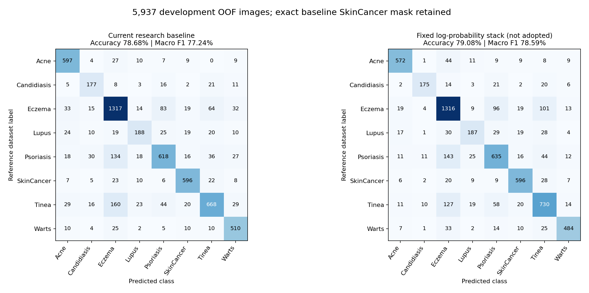

# Thử bộ gộp học từ điểm ba model — 23/10/2026

**Trạng thái: hoàn tất năm fold, đã kiểm chứng; chưa chọn thay baseline.**

## 1. Kết quả tổng trên cùng 5.937 ảnh OOF

| Phương án | Accuracy | Macro F1 | Recall SkinCancer | Số ảnh đúng |
|---|---:|---:|---:|---:|
| Baseline nghiên cứu đang giữ | 78,68% | 77,24% | 88,04% | 4.671/5.937 |
| Bộ gộp thử nguyên bản — chưa được chọn | 79,08% | 78,59% | 88,04% | 4.695/5.937 |
| Phương án chọn bằng validation | 78,68% | 77,24% | 88,04% | 4.671/5.937 |

Bản thử tăng **+0,40 điểm phần trăm Accuracy** và **+1,35 điểm phần trăm Macro F1**. Đổi dự đoán 543 ảnh: sửa đúng 198 ảnh trước đó sai, đồng thời làm sai 174 ảnh trước đó đúng; còn thêm ròng 24 ảnh đúng.

**Đây là tín hiệu phát triển thuận lợi ở bản thử, chưa phải cải thiện của bản đã được chọn.** Cả năm lựa chọn validation giữ baseline. Không đổi điều kiện chọn sau khi thấy outer cao hơn.

## 2. Lần này học thêm gì?

Giữ nguyên ba CNN EfficientNet-B0, ConvNeXt-Tiny và ResNet50. Với mỗi ảnh, lấy tám điểm của từng model, biến đổi log và ghép thành 24 số. Học một Logistic Regression tám nhãn để kết hợp các số đó. Đây là một bộ gộp có học; không train thêm backbone.

- Chỉ dùng dự đoán inner validation của **chính outer fold đang xét** để học bộ gộp. Không lấy OOF của fold khác làm dữ liệu học vì CNN của fold khác có thể từng học ảnh outer đang cần chấm.
- Bên trong inner validation, chia ba phần theo nhóm ca/cảnh. Mỗi scaler và đầu gộp tạm học hai phần, chấm phần còn lại; dùng các điểm giữ lại này để quyết định có chọn bản thử hay không.
- Cố định trước `C=0.1`, L2, loss không cân bằng, log floor `1e-7`, seed chia nhóm 42. Không quét C, trọng số hay ngưỡng trong lượt này.
- Sau khi có quyết định chọn, học đầu cuối trên toàn inner validation. Đầu cuối không dùng điểm tự chấm trên dữ liệu vừa học để xin được chọn.
- Giữ đúng mọi quyết định SkinCancer của baseline. Những ảnh baseline gọi bệnh khác được phân lại giữa bảy nhãn ngoài cancer bằng điểm bộ gộp. Không dùng ngưỡng 0,8 của các đầu chuyên biệt cũ.
- Đủ 15 đầu tạm để cross-fit và năm đầu cuối; lưu năm đầu cuối, log, chỉ số, đường dẫn ảnh và mã chia nhóm. Khóa đủ năm lựa chọn trước chấm outer.

## 3. Vì sao điểm tổng cao hơn mà chưa chọn?

Điều kiện đã định không chỉ yêu cầu tăng điểm tổng: Recall/F1 từng bệnh Lupus, Psoriasis, Tinea không được giảm; precision ba bệnh giảm không quá hai điểm phần trăm, recall các bệnh còn lại giảm không quá hai điểm. Accuracy/Macro F1 không giảm và SkinCancer giữ nguyên. Các cross-fit validation đều chưa đạt đủ.

| Bệnh | Ảnh | Precision cũ → thử | Recall cũ → thử | F1 cũ → thử |
|---|---:|---:|---:|---:|
| Acne | 663 | 82,57% → 88,68% | 90,05% → 86,27% | 86,15% → 87,46% |
| Candidiasis | 243 | 67,82% → 85,37% | 72,84% → 72,02% | 70,24% → 78,12% |
| Eczema | 1577 | 76,88% → 76,20% | 83,51% → 83,45% | 80,06% → 79,66% |
| Lupus | 315 | 70,15% → 70,57% | 59,68% → 59,37% | 64,49% → 64,48% |
| Psoriasis | 897 | 76,87% → 72,90% | 68,90% → 70,79% | 72,66% → 71,83% |
| SkinCancer | 677 | 86,25% → 86,25% | 88,04% → 88,04% | 87,13% → 87,13% |
| Tinea | 989 | 79,43% → 74,19% | 67,54% → 73,81% | 73,01% → 74,00% |
| Warts | 576 | 80,19% → 88,16% | 88,54% → 84,03% | 84,16% → 86,04% |

Trên OOF, Lupus đúng 188 → 187 ảnh, F1 giảm nhẹ. Psoriasis recall tăng nhưng precision và F1 giảm; Tinea recall/F1 tăng nhưng precision giảm hơn hai điểm phần trăm. Giữ SkinCancer đạt được bằng quy tắc giữ nguyên mặt nạ: vẫn 596/677 ảnh SkinCancer đúng, 81 ảnh bỏ sót và cùng các dương tính giả. Quy tắc này chưa sửa những lỗi cancer đã có.

| Fold | Cross-fit validation Accuracy cũ → thử | Macro F1 cũ → thử | Quyết định | Điều kiện chưa đạt |
|---|---:|---:|---|---|
| 0 | 77,72% → 78,83% | 76,66% → 77,28% | Giữ baseline | Lupus_f1, Lupus_recall, precision_Tinea, recall_Candidiasis, recall_Warts |
| 1 | 81,91% → 81,35% | 82,06% → 81,38% | Giữ baseline | Lupus_f1, Lupus_recall, Psoriasis_f1, accuracy, macro_f1, precision_Lupus, precision_Tinea, recall_Acne, recall_Candidiasis, recall_Eczema |
| 2 | 76,79% → 76,23% | 76,57% → 75,27% | Giữ baseline | Lupus_f1, Lupus_recall, Psoriasis_f1, accuracy, macro_f1, precision_Lupus, precision_Psoriasis, recall_Acne, recall_Candidiasis, recall_Warts |
| 3 | 79,35% → 78,65% | 77,97% → 78,36% | Giữ baseline | Psoriasis_f1, Tinea_f1, accuracy, precision_Lupus, precision_Psoriasis, precision_Tinea, recall_Acne, recall_Candidiasis, recall_Warts |
| 4 | 83,24% → 81,98% | 83,68% → 83,23% | Giữ baseline | Lupus_f1, Psoriasis_f1, Tinea_f1, accuracy, macro_f1, precision_Lupus, precision_Psoriasis, precision_Tinea, recall_Acne, recall_Candidiasis, recall_Warts |

Tên điều kiện trong bảng theo `selection_locked.json`: `precision_X`, `recall_X`, `X_f1` là precision, recall, F1 của bệnh X; `accuracy`/`macro_f1` là điểm tổng. Đây là điểm chấm giữ lại của **đầu gộp**, không phải điểm đầu cuối tự chấm sau học toàn inner.

## 4. Outer từng fold và từng nguồn

| Fold | Accuracy cũ → thử | Macro F1 cũ → thử | Được chọn bằng validation |
|---|---:|---:|---|
| 0 | 78,32% → 78,74% | 76,94% → 78,37% | Baseline |
| 1 | 77,62% → 77,95% | 76,55% → 76,60% | Baseline |
| 2 | 80,85% → 80,93% | 80,83% → 82,14% | Baseline |
| 3 | 77,85% → 78,27% | 75,33% → 77,14% | Baseline |
| 4 | 78,73% → 79,50% | 76,23% → 78,26% | Baseline |

Bản thử có Accuracy và Macro F1 cao hơn baseline ở cả năm outer fold trong dữ liệu phát triển này. Các fold dùng train chồng lấn và cùng một seed CNN, nên đây không phải năm thử nghiệm độc lập qua năm seed.

| Nguồn | Ảnh | Accuracy cũ → thử | Macro F1 tám nhãn cũ → thử | Recall Lupus cũ → thử |
|---|---:|---:|---:|---:|
| original_train | 4961 | 80,29% → 80,83% | 79,31% → 80,40% | 61,84% → 61,51% |
| SCIN | 976 | 70,49% → 70,18% | 30,71% → 31,56% | 0,00% → 0,00% |

Macro F1 nguồn vẫn dùng đủ tám nhãn như bộ tính chính; SCIN không có SkinCancer trong cohort này nên F1 lớp đó bằng 0. Không dùng điểm nguồn này để tuyên bố độ chính xác lâm sàng hay so trực tiếp hai nguồn khác phân bố. SCIN Lupus chỉ 11 ảnh/sáu mã ca nguồn.

## 5. Độ bất định và giới hạn

Bootstrap ghép cặp theo nhóm ca/cảnh, 1.000 lần; khoảng 95% cho **chênh lệch bản thử trừ baseline**, đơn vị điểm phần trăm:

| Chỉ số | Chênh lệch | Khoảng bootstrap 95% |
|---|---:|---:|
| Accuracy | +0,40 | [-0,22; +1,04] |
| Macro F1 | +1,35 | [+0,58; +2,13] |

Khoảng Accuracy còn chứa 0. Khoảng Macro F1 dương là mô tả có điều kiện trên các dự đoán phát triển đã có; chưa hiệu chỉnh việc thử nhiều phương án hoặc lựa chọn checkpoint, không phải bằng chứng kiểm định bệnh nhân mới.

Giới hạn quan trọng: CNN cha từng dùng **toàn inner validation để chọn epoch**. Chia nhóm cho đầu gộp không xoá lần tiếp xúc đó. Baseline cũng từng dùng full inner để chọn trọng số, trong khi đầu gộp tạm học hai phần; lịch sử chọn không đối xứng. Đầu cuối còn học nhiều ảnh hơn đầu tạm. Chưa có huấn luyện CNN lồng đầy đủ, nhiều seed hoặc test bệnh nhân mới độc lập.

## 6. Kiểm chứng và nơi đọc bằng chứng

- Mã kiểm chứng khác đường thực thi đã refit đủ **20 đầu**, dựng lại năm lựa chọn, 5.937 dự đoán và **34 bộ chỉ số**: PASS. Đây là kiểm chứng tính toán, không phải bác sĩ hoặc nhóm nghiên cứu bên ngoài thẩm định.
- Kiểm tra SHA nguồn đầu vào/checkpoint, nhóm không chồng lấn, mọi quyết định cancer và dự đoán baseline; 96 script gốc được giữ nguyên.
- Bộ kiểm thử toàn thư mục `tests`: **152/152 đạt**, gồm ba kiểm thử mới cho ranh giới meta-holdout và giữ nguyên quyết định cancer.
- [Giao thức cố định](protocol.json), [năm lựa chọn đã khóa](all_selections_locked.json), [kết quả đủ chỉ số](results.json), [dự đoán từng ảnh](oof_decisions.json), [biên bản kiểm chứng](independent_review.json).
- [Runner](../../training/run_teacher_logprob_stacking.py), [kiểm thử ranh giới](../../tests/test_teacher_logprob_stacking.py).
- Bản nghiên cứu được giữ vẫn **78,68% Accuracy / 77,24% Macro F1 / 88,04% Recall SkinCancer**. API vẫn EfficientNet-B0 đơn. Không sửa checkpoint phục vụ hay báo cáo Word.

## 7. Hướng tiếp theo

Giữ bản thử như ứng viên có triển vọng để kiểm tra thêm. Cần đánh giá trên các ca mới có nhãn đáng tin cậy hoặc một thiết kế đánh giá mới được khóa trước; không chọn lớp/ngưỡng dựa trên những outer đã thấy. Trước khi train thêm, ưu tiên xác minh dữ liệu và nghĩa nhãn của Lupus/Psoriasis/Tinea, đặc biệt SCIN Lupus. Không thể cam kết tăng recall chỉ bằng tiếp tục train.

## Cơ sở kỹ thuật

Tham khảo ý tưởng bộ gộp học từ đầu ra model trong [StackingClassifier](https://scikit-learn.org/1.3/modules/generated/sklearn.ensemble.StackingClassifier.html), đầu tuyến tính điều chuẩn trong [LogisticRegression](https://scikit-learn.org/1.3/modules/generated/sklearn.linear_model.LogisticRegression.html) và giữ nhóm với [StratifiedGroupKFold](https://scikit-learn.org/1.3/modules/generated/sklearn.model_selection.StratifiedGroupKFold.html). Đây là bộ gộp do nhóm triển khai trên các dự đoán cố định, không gọi trực tiếp StackingClassifier hoặc tuyên bố tái lập một bài báo.

