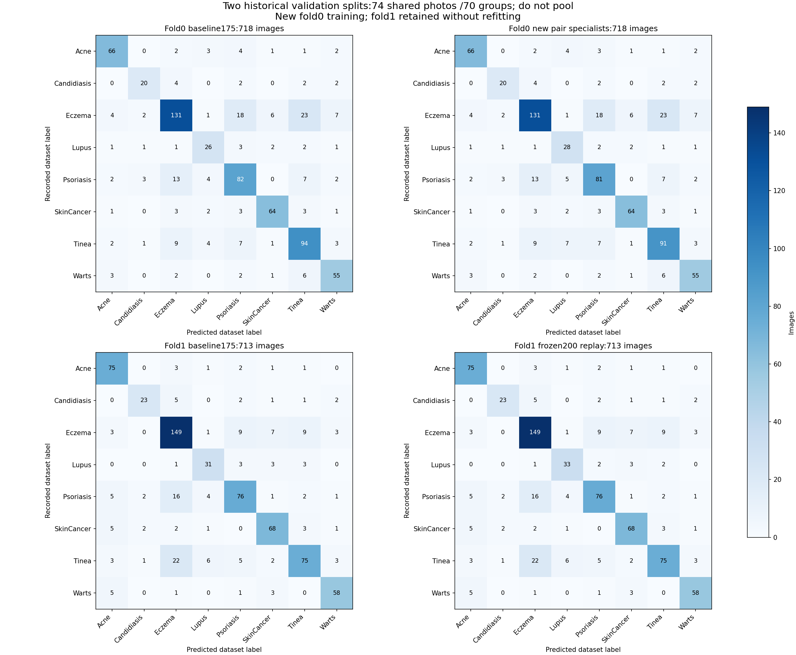

# 201 — Lặp lại công thức hai đầu Lupus trên fold còn lại

**Chưa chứng minh cải thiện ổn định: fold 1 đạt, fold 0 chưa đạt điều kiện.**

Giữ nguyên phương pháp200: hai đầu Lupus/Psoriasis và Lupus/Tinea, cùng feature ConvNeXt ImageNet, loss, lưới C, seed chia nhóm, cách ghép tỷ số và ngưỡng0. Lượt này huấn luyện20 đầu tuyến tính và4 scaler trên4.043 ảnh train fold0; chọn C hoàn toàn trong train. Fold1 tái dùng nguyên trọng số và kết quả200, không train lại hay chọn model theo fold có điểm cao hơn.

| Fold lịch sử | Ảnh validation | Accuracy trước → sau | Macro F1 trước → sau | Recall Lupus trước → sau | Lupus đúng mới / nhầm mới | Đủ điều kiện |
|---|---:|---|---|---|---:|---|
| 0 | 718 | 74,93% → 74,65% | 74,87% → 74,62% | 70,27% → 75,68% | 2 / 5 | Chưa đạt |
| 1 | 713 | 77,84% → 78,12% | 77,60% → 78,06% | 75,61% → 80,49% | 2 / 0 | Đạt |

Fold0 sửa đúng2 Lupus nhưng gọi nhầm thêm5 ảnh thành Lupus: một Psoriasis, ba Tinea và một Acne. Bốn ảnh Pso/Tin trước đó đang đúng bị làm sai; ảnh Acne vốn đã bị gọi Psoriasis nên là sai sang sai. Do đó số đúng giảm538→536/718 dù Recall Lupus tăng. Recall SkinCancer giữ83,12%, nhưng Precision Lupus và một số chỉ số Pso/Tin giảm.

Fold1 giữ nguyên kết quả tốt200: sửa đúng2 Lupus, không lỗi mới; các chỉ số từng bệnh đều không giảm. Không xóa kết quả tốt này hoặc dùng nó để che fold0 chưa đạt.

**Hai validation có74 ảnh chung và70 nhóm chung.** Hai bộ ảnh Lupus tăng đúng còn có1 ảnh trùng nhau, hợp chỉ3 ảnh khác nhau. Không cộng thành4 ảnh Lupus độc lập; không gộp1.431 lượt chấm thành một điểm test mới. Đây là hai split lịch sử đã được xem, chưa phải kiểm tra trên bệnh nhân/nguồn mới.

**Giữ ứng viên200 để nghiên cứu; chưa chọn áp dụng toàn đồ án.** Điểm OOF tổng5.937 ảnh, API và registry giữ nguyên. Hướng cần kiểm chứng tiếp là giảm gọi nhầm Lupus khi chuyển split, trong khi giữ mức tăng nhận Lupus; chưa sửa C/ngưỡng sau kết quả này.

[Bảng đủ tám bệnh, nguồn, kiểm chứng và ma trận](summary.md). [Pilot200](../teacher_lupus_coupled_pair_specialist_fold1_20261029/summary.md).

## Fold 0: đủ tám nhóm nhãn

| Nhãn | P trước | R trước | F1 trước | P sau | R sau | F1 sau |
|---|---:|---:|---:|---:|---:|---:|
| Acne | 83,54% | 83,54% | 83,54% | 83,54% | 83,54% | 83,54% |
| Candidiasis | 74,07% | 66,67% | 70,18% | 74,07% | 66,67% | 70,18% |
| Eczema | 79,39% | 68,23% | 73,39% | 79,39% | 68,23% | 73,39% |
| Lupus | 65,00% | 70,27% | 67,53% | 59,57% | 75,68% | 66,67% |
| Psoriasis | 67,77% | 72,57% | 70,09% | 68,64% | 71,68% | 70,13% |
| SkinCancer | 85,33% | 83,12% | 84,21% | 85,33% | 83,12% | 84,21% |
| Tinea | 68,12% | 77,69% | 72,59% | 67,91% | 75,21% | 71,37% |
| Warts | 75,34% | 79,71% | 77,46% | 75,34% | 79,71% | 77,46% |

Đối chiếu điều kiện đã đăng ký:

- accuracy_below_parent
- no_macro_f1_gain
- Lupus_precision_below_parent
- Lupus_f1_below_parent
- Psoriasis_recall_below_parent
- Tinea_precision_below_parent
- Tinea_recall_below_parent
- Tinea_f1_below_parent

## Fold 1: đủ tám nhóm nhãn

| Nhãn | P trước | R trước | F1 trước | P sau | R sau | F1 sau |
|---|---:|---:|---:|---:|---:|---:|
| Acne | 78,12% | 90,36% | 83,80% | 78,12% | 90,36% | 83,80% |
| Candidiasis | 82,14% | 67,65% | 74,19% | 82,14% | 67,65% | 74,19% |
| Eczema | 74,87% | 82,32% | 78,42% | 74,87% | 82,32% | 78,42% |
| Lupus | 70,45% | 75,61% | 72,94% | 71,74% | 80,49% | 75,86% |
| Psoriasis | 77,55% | 71,03% | 74,15% | 78,35% | 71,03% | 74,51% |
| SkinCancer | 79,07% | 82,93% | 80,95% | 79,07% | 82,93% | 80,95% |
| Tinea | 79,79% | 64,10% | 71,09% | 80,65% | 64,10% | 71,43% |
| Warts | 85,29% | 85,29% | 85,29% | 85,29% | 85,29% | 85,29% |

Đối chiếu điều kiện đã đăng ký:

- Không có guard thất bại ở fold này.

## Lupus theo nguồn: cỡ mẫu nhỏ

| Fold | Nguồn | Ảnh nhãn Lupus | Recall trước | Recall sau | Precision sau |
|---|---|---:|---:|---:|---:|
| 0 | SCIN | 1 | 0,00% | 0,00% | 0,00% |
| 0 | original_train | 36 | 72,22% | 77,78% | 60,87% |
| 1 | SCIN | 2 | 50,00% | 50,00% | 25,00% |
| 1 | original_train | 39 | 76,92% | 82,05% | 76,19% |

Các ảnh đổi nhãn của cả hai fold đều thuộc nguồn cũ. SCIN không có gain mới: fold0 chỉ1 ảnh Lupus và không nhận đúng; fold1 có2 ảnh, nhận1. Không dùng0/1 hoặc1/2 để khẳng định độ chính xác nguồn SCIN hoặc nguyên nhân thấp; chưa có rà nhãn bác sĩ/test nguồn mới. Đây vẫn là phần chưa đáp ứng đầy đủ yêu cầu tổng quát hóa của thầy.

## Công thức và sự lặp lại

Điểm ghép giữ nguyên `-logaddexp(-margin_LP_Pso,-margin_LP_Tin)`. Chỉ parent dự đoán Pso/Tin mới được đổi sang Lupus khi điểm>0. Mọi Lupus cũ và mặt nạ năm lớp ngoài weak, gồm SkinCancer, giữ nguyên. Guard của200 áp riêng mỗi fold: Accuracy không giảm, Macro F1 tăng, mọi P/R/F1 tám bệnh không giảm và ít nhất một Recall bệnh yếu tăng. Không giảm chuẩn sau fold0 chưa đạt.

Fold0:4.043 train,718 inner validation,1.176 outer chính; cả ba vai trò không trùng đường dẫn/SHA/nhóm. Train có1.533 trueweak,205 Lupus; cặp LP/Pso844 ảnh, LP/Tin894 ảnh. Mỗi CV scaler fit đủ all8 subtrain; mỗi đầu chỉ fit đúng nhãn cặp. Ba CV nhóm seed28168, C0,0001/0,001/0,01,18 fit CV và2 đầu cuối. Chọn hai C cùng0,01 theo logloss LP ghép TRAIN CV; không sao chép C theo điểm validation. Tổng thể hai lượt200/201 có40 fit, nhưng chỉ lượt201 mới thêm20 fit; không có40 CNN mới.

Fit mới bốn scaler có cùng định nghĩa với196/200; kiểm thử đã tái tạo chính xác bốn scaler fold1 cũ trước huấn luyện mới. Loss tổng binary logloss tự nhiên +0,5×norm(w)²/C, intercept không phạt, zero769 tham số; optimizer/giới hạn hội tụ giữ nguyên200. Không thay backbone, feature cache, augmentation, loss weighting hoặc ngưỡng. Parent175 CNN cũ được giữ, không tái train; việc này không hoàn tất ba pipeline parent crossfit fold0 còn thiếu trong kế hoạch185.

## Kiểm chứng và kết luận

Hai kiểm thử PASS trong4,48giây: định nghĩa preprocessing mới tái tạo đúng bốn scaler fold1 đã khóa; phần giữ ngoài không ảnh hưởng scaler và không ghép nhầm đường dẫn/nhãn parent. Reviewer kiểm20 objective/gradient của đầu mới,4 scaler, split/nhãn cặp,9 C choices, margin/coupling; replay forward hai đầu cuối fold1 cũ; tái kiểm SHA của5.937 ảnh,14 bộ chỉ số và14.310 vị trí mask bảo vệ. Gradient tối đa2,4606e-6. Đây là kiểm stationarity/forward, không fit lại độc lập toàn bộ CNN/20 đầu.

Input/code/tests/reviewer/protocol khóa trước fit; weights/scalers/C khóa trước suy luận718 ảnh; đầu ra fold0 và replay fold1 khóa trước tính chỉ số. `primary_both_fold_pass=false`: tăng Recall Lupus có lặp lại nhưng chất lượng tám bệnh chưa giữ được qua split. `pooled_metrics_computed=false`, `selected=null`. Không có điểm tổng mới, triển khai mới hoặc kết luận lâm sàng.

[Protocol](protocol.json), [kết quả](results.json), [kiểm chứng](independent_review.json), [log fit](training_report.json), [chọn C](selection.json), [ca đổi nhãn](changed_cases.json), [chồng lắp các ảnh sửa đúng](reporting_diagnostics.json).
