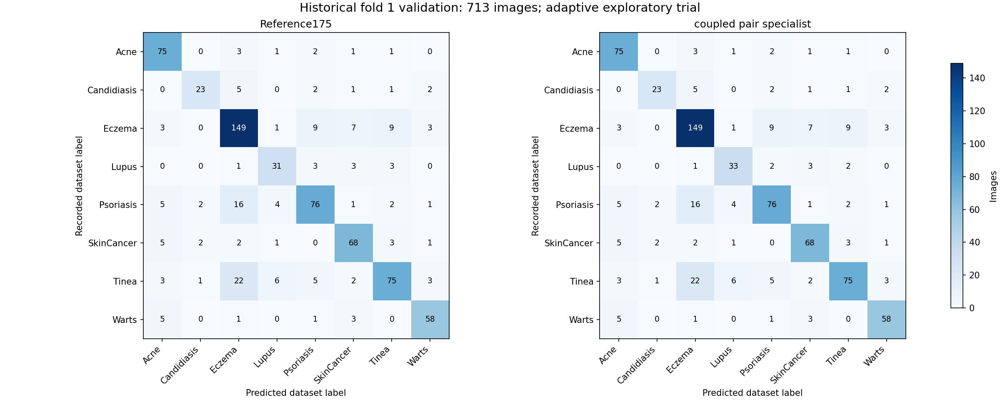

# Kết quả pilot đầu chuyên biệt 200

**Qua điều kiện của pilot một fold; chưa đủ để chọn mô hình toàn đồ án.**

Huấn luyện hai loại đầu chuyên biệt: Lupus–Psoriasis và Lupus–Tinea, trên cùng đặc trưng ConvNeXt ImageNet đóng băng. Chọn cặp C bằng ba phần chia nhóm trong 4.031 ảnh train, ghép hai tỷ số thành một điểm Lupus chung. Tổng 20 lượt fit gồm 18 lượt CV và 2 đầu cuối; tái dùng 4 scaler, giữ CNN. Chỉ thêm Lupus từ dự đoán Psoriasis/Tinea, giữ mọi dự đoán Lupus cũ. Kết quả dưới đây trên **cùng 713 ảnh validation lịch sử**, đã từng được xem và dùng chọn checkpoint parent. Đây không phải test bệnh nhân mới hoặc điểm OOF tổng trên 5.937 ảnh.

| Chỉ số | Baseline 175 | Công thức chính mới | Chênh lệch |
|---|---:|---:|---:|
| Accuracy | 77,84% | 78,12% | +0,28 điểm % |
| Macro F1 | 77,60% | 78,06% | +0,45 điểm % |
| Recall SkinCancer | 82,93% | 82,93% | +0,00 điểm % |
| Recall Lupus | 75,61% | 80,49% | +4,88 điểm % |
| Recall Psoriasis | 71,03% | 71,03% | +0,00 điểm % |
| Recall Tinea | 64,10% | 64,10% | +0,00 điểm % |

Công thức chính `coupled_pair_specialist` đổi 2 dự đoán, sửa đúng 2 ảnh và làm sai thêm 0 ảnh. Mọi dự đoán SkinCancer và bốn nhóm ngoài ba bệnh yếu giữ nguyên. Mọi dự đoán Lupus cũ được giữ. Lượt này đã đối chiếu đầy đủ: mọi Precision/Recall/F1 của tám bệnh đều không giảm.

**Chưa có kết luận tăng ổn định trên toàn đồ án.** Cần đọc đủ Recall/F1 từng bệnh và điều kiện chọn; không chọn đối chứng chỉ vì điểm tổng cao hơn. API, registry và điểm tổng cũ giữ nguyên. Công thức mới chưa được lặp lại trên fold khác; điểm OOF tổng chưa thay đổi.

## Các công thức đã đăng ký

| Công thức | Accuracy | Macro F1 | Recall Lupus | Sửa đúng | Làm sai | Đạt guard |
|---|---:|---:|---:|---:|---:|---|
| zero_step175 | 77,84% | 77,60% | 75,61% | 0 | 0 | False |
| previous196_weak_focus | 77,84% | 77,65% | 78,05% | 1 | 1 | False |
| coupled_pair_specialist | 78,12% | 78,06% | 80,49% | 2 | 0 | True |

Chỉ `coupled_pair_specialist` là công thức chính. Đối chứng là thông tin so sánh, không thay cho công thức chính sau khi đọc kết quả. Giữ đúng các điều kiện cũ: Accuracy không giảm, Macro F1 tăng, toàn bộ P/R/F1 tám nhóm không giảm và ít nhất một Recall bệnh yếu tăng. Không nới điều kiện sau kết quả.

## Tám nhóm nhãn của công thức chính

| Nhãn | P cũ | R cũ | F1 cũ | P mới | R mới | F1 mới |
|---|---:|---:|---:|---:|---:|---:|
| Acne | 78,12% | 90,36% | 83,80% | 78,12% | 90,36% | 83,80% |
| Candidiasis | 82,14% | 67,65% | 74,19% | 82,14% | 67,65% | 74,19% |
| Eczema | 74,87% | 82,32% | 78,42% | 74,87% | 82,32% | 78,42% |
| Lupus | 70,45% | 75,61% | 72,94% | 71,74% | 80,49% | 75,86% |
| Psoriasis | 77,55% | 71,03% | 74,15% | 78,35% | 71,03% | 74,51% |
| SkinCancer | 79,07% | 82,93% | 80,95% | 79,07% | 82,93% | 80,95% |
| Tinea | 79,79% | 64,10% | 71,09% | 80,65% | 64,10% | 71,43% |
| Warts | 85,29% | 85,29% | 85,29% | 85,29% | 85,29% | 85,29% |

Đối chiếu điều kiện đã đăng ký:

- Không có guard thất bại; kết quả một fold vẫn chỉ cho phép nghiên cứu tiếp.

## Đầu chuyên biệt từng cặp bệnh

Đầu196 học Lupus đối với tổng Psoriasis/Tinea. Lượt200 tách thành hai đầu: LP/Pso và LP/Tin. Hai đầu cùng dùng217 ảnh Lupus; đầu thứ nhất có826 ảnh (217 LP+609 Pso), đầu thứ hai có880 ảnh (217 LP+663 Tin). Hợp hai tập vẫn1.489 ảnh riêng, không phải thêm1.706 ảnh mới. Train gốc4.031 ảnh và bài toán đánh giá tám bệnh giữ nguyên.

Cùng768 đặc trưng ConvNeXt ImageNet đóng băng, cùng các nhóm chia train và bốn scaler của196. Trong mỗi fold CV, scaler đã fit trên all8 subtrain; mỗi đầu chỉ dùng ảnh có nhãn thật thuộc cặp của nó để tính loss. Không fit nhóm giữ ngoài. Cùng loss tự nhiên tổng binary logloss +0,5×norm(w)²/C, intercept không phạt; không class weighting, hard mining hoặc tăng cường ảnh mới trong lượt này.

## Ghép tỷ số để giữ đúng phạm vi ba bệnh

Gọi mP là margin LP/Pso và mT là margin LP/Tin. Ghép thành:

`q(LP) = 1 / (1 + exp(-mP) + exp(-mT))`

Điểm binary LP ổn định số học là `-logaddexp(-mP,-mT)`. Hai đầu có margin dương riêng chưa đủ: phải vượt tổng điểm hai bệnh còn lại. Khi chỉ có intercept theo tần suất thật, công thức khôi phục prior LP của toàn ba bệnh, tránh dùng prior LP cao hơn của riêng một cặp như thể quần thể không thay đổi. Các đầu discriminative vẫn có thể thiếu nhất quán/hiệu chỉnh; q không phải xác suất lâm sàng đã kiểm chứng.

Chỉ khi parent175 đang gọi Pso/Tin và điểm LP ghép>0 mới đổi thành Lupus. Giữ mọi Lupus cũ, SkinCancer và bốn nhãn ngoài weak. Không dùng nhãn thật, tên ảnh, nguồn hoặc chọn riêng ca đúng khi suy luận.

## Chọn tham số trong train

Tái dùng ba phép chia nhóm SGKF seed28168. Mỗi đầu có C0,0001/0,001/0,01: tổng18 fit CV. Ghép margin giữ ngoài để chấm9 cặp C bằng logloss binary Lupus/không Lupus trên cùng1.489 trueweak TRAIN CV; chọn thấp nhất, hòa1e-12 chọn C Pso nhỏ hơn rồi C Tin nhỏ hơn. Hai đầu cuối fit sau lựa chọn; tổng20 fit mới, không phải20 CNN.

| C LP/Pso | C LP/Tin | Logloss điểm LP ghép TRAIN CV |
|---|---|---:|
| 0,0001 | 0,0001 | 0,369745134 |
| 0,0001 | 0,001 | 0,334276599 |
| 0,0001 | 0,01 | 0,313818004 |
| 0,001 | 0,0001 | 0,337723542 |
| 0,001 | 0,001 | 0,306244254 |
| 0,001 | 0,01 | 0,286986537 |
| 0,01 | 0,0001 | 0,317890707 |
| 0,01 | 0,001 | 0,288440448 |
| **0,01** | **0,01** | **0,272146086** |

Cả hai chọn0,01 trước suy luận validation. Không dùng logloss của từng cặp để chọn riêng hai C hoặc dùng điểm713 ảnh để đổi C/ngưỡng. Logloss TRAIN CV sau lựa chọn có thiên lệch chọn tham số và không phải điểm OOF tám bệnh. So RBF198 có logloss binary tốt hơn nhưng không sửa dự đoán main, nên vẫn cần nhìn kết quả ghép đủ tám bệnh.

L-BFGS-B tối đa6.000 vòng, gtol1e-8, ftol1e-15, maxls50, zero769 tham số mỗi đầu; yêu cầu success và gradient tối đa<0,001. Đủ20 fit qua; gradient tối đa4,3653e-6 khi reviewer đối chiếu. Không thay kiến trúc CNN, feature, scaler hoặc checkpoint serving.

## Kết quả pilot đã qua điều kiện

Trên cùng713 validation lịch sử, số đoán đúng555→557. Hai ảnh có nhãn Lupus trước bị gọi Pso và Tin được sửa thành Lupus; không có ảnh mới bị làm sai. Các chỉ số:

- Accuracy77,84%→78,12% (+0,28 điểm%).
- Macro F177,60%→78,06% (+0,45 điểm%).
- Lupus: Precision70,45%→71,74%, Recall31/41→33/41 (75,61%→80,49%), F172,94%→75,86%.
- Psoriasis: Recall76/107=71,03% giữ nguyên, F174,15%→74,51% do bớt một dự đoán nhầm vào lớp này.
- Tinea: Recall75/117=64,10% giữ nguyên, F171,09%→71,43% do bớt một dự đoán nhầm vào lớp này.
- SkinCancer: Recall68/82=82,93% và mọi P/R/F1 giữ nguyên; các nhãn còn lại cũng không đổi.

Toàn bộ P/R/F1 tám bệnh không giảm; Accuracy tăng, Macro F1 tăng, Recall Lupus tăng. Vì vậy `primary_guard_pass=true` cho pilot một fold. Recall Pso/Tin chưa tăng; không nói cả ba Recall đều tăng. So ứng viên196, lượt này giữ mức tăng Lupus và thêm một ảnh LP nữa, đồng thời không giữ lỗi Psoriasis đã làm196 chưa đạt.

## Kiểm chứng và giới hạn

Ba kiểm thử PASS trong4,11giây: hai prior cặp tái tạo prior chung, coupling ổn định/đối xứng/đơn điệu và điều kiện thắng tổng hai bệnh, chọn cặp C với tie cố định/số chưa làm tròn. Reviewer dựng lại các nhóm/ảnh loss từng cặp,4 scaler,20 objective/gradient/CV margin,9 điểm chọn C, hai đầu cuối,713 quyết định,10 bộ chỉ số và10.695 vị trí mask bảo vệ. Công thức độc lập dùng logsumexp ba khối lượng để đối chiếu logaddexp của production. Kiểm stationarity và forward, không train lại độc lập toàn bộ CNN/20 đầu.

Source/tests/reviewer/input/protocol khóa trước fit;20 đầu/CV/C choice khóa trước validation; mọi dự đoán khóa trước tính điểm. Hai ca tăng thuộc nguồn cũ; Lupus SCIN validation vẫn1/2 ảnh nhận đúng, không có kết luận cải thiện trên SCIN từ lượt này.713 ảnh đã được xem nhiều lần nên đây vẫn là pilot thích nghi, chưa đủ chứng minh ổn định hoặc tổng quát hóa. Bước xác nhận cần giữ nguyên công thức và điều kiện, lặp lại theo fold/nhóm train; không tiếp tục sửa chỉ để khớp hai ca này.

Giữ toàn bộ trọng số ứng viên200 để tái lập. Hai đầu cuối là [LP/Psoriasis](../../candidates/teacher_lupus_coupled_pair_specialist_fold1_20261029/psoriasis_final.npz) và [LP/Tinea](../../candidates/teacher_lupus_coupled_pair_specialist_fold1_20261029/tinea_final.npz); chúng cần đúng feature ConvNeXt, scaler và parent175 đã ghi trong protocol, không phải hai model nhận ảnh trực tiếp độc lập. `selected=null`, chưa cập nhật API/registry hoặc điểm OOF tổng5.937 ảnh. PASS ở đây xác nhận đúng phép tính và qua điều kiện pilot một fold; không phải chứng nhận độ chính xác lâm sàng.

## Kiểm chứng và phạm vi

Code, kiểm thử, reviewer và protocol được khóa SHA trước fit mới. Khóa trọng số và dữ liệu học trước dự đoán mới, khóa toàn bộ dự đoán trước tính chỉ số. Reviewer dựng lại dữ liệu học/đặc trưng/nhãn/trọng số cần dùng, objective/gradient, margin và scalar route, chỉ số/từng ca thay đổi/guard. Kế thừa lineage của các đầu phụ và parent giữ ngoài đã kiểm chứng; không tuyên bố fit lại độc lập toàn bộ CNN/đầu phụ.

Hai đầu dùng chung217 Lupus; đầu LP/Pso học826 ảnh, đầu LP/Tin học880 ảnh, hợp hai tập vẫn1.489 ảnh riêng. Chọn hai C theo logloss điểm Lupus sau ghép trên TRAIN CV, không dùng713 validation chọn C hoặc ngưỡng. Parent175 chỉ dùng lúc áp dụng và so sánh. Hypothesis phát triển sau nhiều lượt trên dữ liệu cũ nên cùng validation lịch sử vẫn là thăm dò; gain hai ảnh chưa chứng minh ổn định qua fold/seed/nguồn hoặc bệnh nhân mới. `single_fold_only=true`, `all_six_jobs_complete=false`, `selected=null`.

## Hồ sơ

- [Protocol](protocol.json), [kết quả](results.json), [kiểm chứng](independent_review.json), [ca thay đổi](changed_cases.json).
- [Log học](training_report.json), [khóa trọng số](training_locked.json), [khóa dự đoán](prediction_locked.json).
