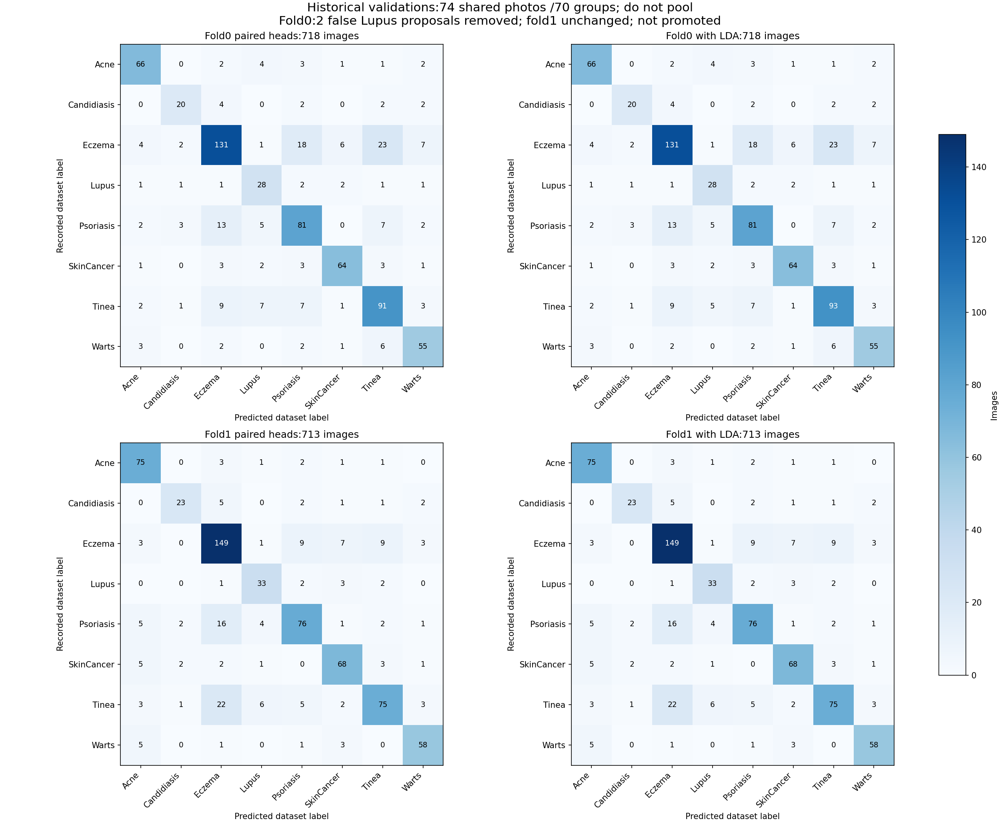

# 204 — Xác nhận Lupus bằng LDA có điều chuẩn

**Có cải thiện cục bộ so với hai đầu200/201; chưa đạt điều kiện thay bản chính.** Fold0 chặn đúng thêm hai ảnh Tinea bị gọi nhầm thành Lupus, không mất ảnh Lupus đang nhận đúng. Fold1 giữ nguyên kết quả200.

| Fold lịch sử | Ảnh | Accuracy hai đầu cũ → thêm xác nhận | Macro F1 cũ → mới | Recall Lupus cũ → mới | Lupus nhầm mới so175: cũ → mới | Đủ điều kiện |
|---|---:|---|---|---|---:|---|
| 0 | 718 | 74,65% → 74,93% | 74,62% → 74,95% | 75,68% → 75,68% | 5 → 3 | Chưa đạt |
| 1 | 713 | 78,12% → 78,12% | 78,06% → 78,06% | 80,49% → 80,49% | 0 → 0 | Đạt |

Recall Lupus giữ28/37 ở fold0 và33/41 ở fold1; trong đó mỗi fold giữ hai Lupus đúng thêm so175. Recall SkinCancer giữ nguyên64/77 và68/82. **Đây là điểm của hai validation lịch sử, chưa phải mức tăng Accuracy/Macro F1 tổng5.937 ảnh.** Hai validation chung74 ảnh/70 nhóm, không cộng làm test mới.

Tại fold0, so baseline175: Accuracy bằng74,93%; Macro F1 nhích từ74,87% lên74,95%, nhưng precision Lupus và recall Psoriasis/Tinea còn giảm. Vì vậy ứng viên chỉ được lưu để nghiên cứu tiếp, `selected=null`; chưa có thay thế bản chính hoặc API.

Đã học8 đầu LDA nhỏ: sáu lượt kiểm tra chia nhóm trong train và hai đầu cuối. Dùng lại đặc trưng ConvNeXt768 chiều, tám scaler cũ (bốn ở mỗi fold), không train thêm CNN hoặc backbone. LDA học phân bố ba bệnh bằng prior tự nhiên và covariance điều chuẩn tự động. Bộ này chỉ xác nhận đề xuất Lupus của200/201; không tạo thêm đề xuất ngoài vùng đã cho phép.

Hai kiểm thử PASS. Đối chiếu độc lập đã dựng lại8 đầu bằng công thức moment và giải Cholesky, kiểm tra20 bộ chỉ số cùng21.465 vị trí mặt nạ bảo vệ. PASS xác nhận phép tính và hồ sơ, không phải chứng nhận chất lượng lâm sàng.

[Đủ tám bệnh, train CV, điều kiện, ca đổi nhãn và ma trận](summary.md). [Lượt gộp trước203](../teacher_lupus_pair_cv_bagging_twofold_20261031/summary.md).

## Cách học và tài liệu tham khảo

Giữ nguyên ảnh,768 đặc trưng ConvNeXt ImageNet, bộ chia SGKF3 seed28168, scaler ALL8-subtrain và hai đầu200/201. Thay đổi duy nhất trong luật đề xuất là thêm xác nhận từ đầu LDA mới. Mỗi LDA học chỉ các ảnh thật sự mang nhãn Lupus/Psoriasis/Tinea; dùng `LinearDiscriminantAnalysis(solver="lsqr", shrinkage="auto", priors=None)` của scikit-learn1.3.2. Prior là tần suất ba bệnh trong phần fit; không cân lại lớp hoặc tìm C/ngưỡng/seed trên validation. Tám scaler ALL8 cũ được tái dùng; không fit scaler mới.

LDA mô hình hóa phân bố đặc trưng từng lớp với ma trận hiệp phương sai dùng chung. Shrinkage tự động ước lượng hệ số Ledoit–Wolf từ train. Đây là cơ chế điều chuẩn cho covariance; không chứng minh giả định Gaussian của ảnh da là đúng hoặc đảm bảo tăng điểm. Phương pháp và công thức được tham khảo từ [hướng dẫn chính thức scikit-learn1.3.2](https://scikit-learn.org/1.3/modules/lda_qda.html#shrinkage-and-covariance-estimator) và [API LDA](https://scikit-learn.org/1.3/modules/generated/sklearn.discriminant_analysis.LinearDiscriminantAnalysis.html). Không tuyên bố tái lập một bài báo chẩn đoán da hay đề xuất kiến trúc CNN mới.

Với ba điểm lớp sLP,sPso,sTin, tính m=sLP−logsumexp(sPso,sTin). Chỉ khi parent175 là Pso/Tin, đầu200/201 đã đề xuất Lupus và m>0 mới đổi sang Lupus. Nếu bộ xác nhận không đồng ý, trở về nhãn175. Ngưỡng tương đương điểm xác suất LP trong ba lớp>0,5; đây là quy tắc kỹ thuật, không phải độ tin cậy lâm sàng. Tất cả Lupus có sẵn trong175 và năm mặt nạ bệnh ngoài bộ ba giữ nguyên.

Sáu đầu CV chỉ cung cấp chẩn đoán chia nhóm trên TRAIN; không chọn tham số hoặc chọn bỏ đầu nào từ các điểm đó. Mỗi head/scaler không dùng nhóm query của mình để fit. Hai đầu cuối dùng toàn bộ weak TRAIN của từng fold. Khóa đủ8 trọng số, report train và đầu ra CV trước khi suy luận hai validation; khóa dự đoán trước khi chấm chỉ số.

Điều kiện giữ nguyên từ202/203: Accuracy≥175, Macro F1>175, P/R/F1 từng bệnh không giảm so175, ít nhất một Recall bệnh yếu tăng; đồng thời giữ Recall Lupus đã tăng của200/201 và Accuracy/Macro F1 tốt của200 tại fold1. Không thay điều kiện sau khi thấy fold0 tăng.

## Chẩn đoán TRAIN chia nhóm — không phải điểm tám bệnh hoặc test

| Fold | Ảnh weak | Accuracy ba lớp OOF trong train | NLL ba lớp |
|---|---:|---:|---:|
| 0 | 1533 | 71,82% | 1.157908 |
| 1 | 1489 | 71,39% | 1.186502 |

NLL không được dùng so trực tiếp với binary NLL của các lượt196–203 vì khác số nhãn và nhiệm vụ. Điểm TRAIN CV này không phải Accuracy tổng của hệ thống; không fit trên validation để chọn tham số.

## Fold 0 — 718 ảnh lịch sử

### Baseline175

Accuracy 74,93%; Macro F1 74,87%.

| Bệnh | Precision | Recall | F1 | Ảnh nhãn gốc |
|---|---:|---:|---:|---:|
| Acne | 83,54% | 83,54% | 83,54% | 79 |
| Candidiasis | 74,07% | 66,67% | 70,18% | 30 |
| Eczema | 79,39% | 68,23% | 73,39% | 192 |
| Lupus | 65,00% | 70,27% | 67,53% | 37 |
| Psoriasis | 67,77% | 72,57% | 70,09% | 113 |
| SkinCancer | 85,33% | 83,12% | 84,21% | 77 |
| Tinea | 68,12% | 77,69% | 72,59% | 121 |
| Warts | 75,34% | 79,71% | 77,46% | 69 |
### Hai đầu200/201

Accuracy 74,65%; Macro F1 74,62%.

| Bệnh | Precision | Recall | F1 | Ảnh nhãn gốc |
|---|---:|---:|---:|---:|
| Acne | 83,54% | 83,54% | 83,54% | 79 |
| Candidiasis | 74,07% | 66,67% | 70,18% | 30 |
| Eczema | 79,39% | 68,23% | 73,39% | 192 |
| Lupus | 59,57% | 75,68% | 66,67% | 37 |
| Psoriasis | 68,64% | 71,68% | 70,13% | 113 |
| SkinCancer | 85,33% | 83,12% | 84,21% | 77 |
| Tinea | 67,91% | 75,21% | 71,37% | 121 |
| Warts | 75,34% | 79,71% | 77,46% | 69 |
### Hai đầu + xác nhận LDA204

Accuracy 74,93%; Macro F1 74,95%.

| Bệnh | Precision | Recall | F1 | Ảnh nhãn gốc |
|---|---:|---:|---:|---:|
| Acne | 83,54% | 83,54% | 83,54% | 79 |
| Candidiasis | 74,07% | 66,67% | 70,18% | 30 |
| Eczema | 79,39% | 68,23% | 73,39% | 192 |
| Lupus | 62,22% | 75,68% | 68,29% | 37 |
| Psoriasis | 68,64% | 71,68% | 70,13% | 113 |
| SkinCancer | 85,33% | 83,12% | 84,21% | 77 |
| Tinea | 68,38% | 76,86% | 72,37% | 121 |
| Warts | 75,34% | 79,71% | 77,46% | 69 |

Điều kiện chưa đạt:

- Lupus_precision_below_parent
- Psoriasis_recall_below_parent
- Tinea_recall_below_parent
- Tinea_f1_below_parent

Theo nguồn, hai đầu cũ → thêm LDA (không chọn riêng theo nguồn):

| Nguồn | Ảnh Lupus | Accuracy | Macro F1 | Recall Lupus |
|---|---:|---|---|---|
| SCIN | 1 | 64,49% → 64,49% | 25,28% → 25,28% | 0,00% → 0,00% |
| original_train | 36 | 76,43% → 76,76% | 76,60% → 76,94% | 77,78% → 77,78% |

Ca đổi nhãn so200/201:

- `SkinDisease/train/Tinea/tinea-face-8.jpeg`: nhãn dữ liệu Tinea; Lupus → Tinea.
- `SkinDisease/train/Tinea/tinea-scalp-21.jpeg`: nhãn dữ liệu Tinea; Lupus → Tinea.

## Fold 1 — 713 ảnh lịch sử

### Baseline175

Accuracy 77,84%; Macro F1 77,60%.

| Bệnh | Precision | Recall | F1 | Ảnh nhãn gốc |
|---|---:|---:|---:|---:|
| Acne | 78,12% | 90,36% | 83,80% | 83 |
| Candidiasis | 82,14% | 67,65% | 74,19% | 34 |
| Eczema | 74,87% | 82,32% | 78,42% | 181 |
| Lupus | 70,45% | 75,61% | 72,94% | 41 |
| Psoriasis | 77,55% | 71,03% | 74,15% | 107 |
| SkinCancer | 79,07% | 82,93% | 80,95% | 82 |
| Tinea | 79,79% | 64,10% | 71,09% | 117 |
| Warts | 85,29% | 85,29% | 85,29% | 68 |
### Hai đầu200/201

Accuracy 78,12%; Macro F1 78,06%.

| Bệnh | Precision | Recall | F1 | Ảnh nhãn gốc |
|---|---:|---:|---:|---:|
| Acne | 78,12% | 90,36% | 83,80% | 83 |
| Candidiasis | 82,14% | 67,65% | 74,19% | 34 |
| Eczema | 74,87% | 82,32% | 78,42% | 181 |
| Lupus | 71,74% | 80,49% | 75,86% | 41 |
| Psoriasis | 78,35% | 71,03% | 74,51% | 107 |
| SkinCancer | 79,07% | 82,93% | 80,95% | 82 |
| Tinea | 80,65% | 64,10% | 71,43% | 117 |
| Warts | 85,29% | 85,29% | 85,29% | 68 |
### Hai đầu + xác nhận LDA204

Accuracy 78,12%; Macro F1 78,06%.

| Bệnh | Precision | Recall | F1 | Ảnh nhãn gốc |
|---|---:|---:|---:|---:|
| Acne | 78,12% | 90,36% | 83,80% | 83 |
| Candidiasis | 82,14% | 67,65% | 74,19% | 34 |
| Eczema | 74,87% | 82,32% | 78,42% | 181 |
| Lupus | 71,74% | 80,49% | 75,86% | 41 |
| Psoriasis | 78,35% | 71,03% | 74,51% | 107 |
| SkinCancer | 79,07% | 82,93% | 80,95% | 82 |
| Tinea | 80,65% | 64,10% | 71,43% | 117 |
| Warts | 85,29% | 85,29% | 85,29% | 68 |

Điều kiện chưa đạt:

- Không có ở fold này; một fold đạt vẫn chưa đủ để chọn cả phương pháp.

Theo nguồn, hai đầu cũ → thêm LDA (không chọn riêng theo nguồn):

| Nguồn | Ảnh Lupus | Accuracy | Macro F1 | Recall Lupus |
|---|---:|---|---|---|
| SCIN | 2 | 68,14% → 68,14% | 27,80% → 27,80% | 50,00% → 50,00% |
| original_train | 39 | 80,00% → 80,00% | 80,32% → 80,32% | 82,05% → 82,05% |

Ca đổi nhãn so200/201:

- Không đổi nhãn.

## Kiểm chứng và giới hạn

Hai kiểm thử PASS trong8,78giây: xác nhận LP cần lớn hơn tổng hai lớp còn lại, bất biến khi cộng hằng số, số học ở margin cực trị; kiểm tra xác nhận chỉ bỏ đề xuất cũ và giữ mặt nạ bệnh bảo vệ. Reviewer không gọi `LDA.fit` hoặc private LDA trong phép dựng lại: tính shrinkage từ moment bậc hai/bốn của dữ liệu chuẩn hóa từng lớp, ghép covariance theo prior, giải Cholesky để khôi phục hệ số và intercept. Vẫn dùng NumPy/SciPy và StandardScaler làm thư viện số học; không phải hai hệ thống hoàn toàn độc lập.

Cả8 đầu khớp: sai khác hệ số tối đa6,42e-14, intercept8,89e-15, covariance4,45e-16. Đối chiếu toàn bộ fit/query, scaler,8 bộ trọng số, hai train-CV,20 bộ chỉ số và21.465 vị trí mặt nạ. Không train lại độc lập CNN gốc hoặc có nhãn bác sĩ mới.

Lupus SCIN vẫn có rất ít ảnh; hai validation chung74 ảnh/70 nhóm và đã được đọc nhiều lần. Không có điểm tổng mới, đánh giá bệnh nhân mới hoặc kết luận tổng quát hóa mới. Bộ xác nhận chỉ loại bớt đề xuất200/201 nên không có khả năng tự tìm Lupus mới mà hai đầu cũ bỏ sót, và không sửa lỗi giữa Pso/Tin ngoài các đề xuất này.

**Giữ checkpoint204 làm ứng viên có tín hiệu giảm gọi nhầm để nghiên cứu tiếp; không thay baseline175, API hoặc registry.** `primary_both_fold_pass=false`, `selected=null`. Các lượt sau phải giữ tiêu chí đã công bố và chọn bằng train, không sửa ngoại lệ theo hai ảnh vừa được khôi phục.

[Protocol](protocol.json), [huấn luyện](training_report.json), [khóa trọng số](training_locked.json), [khóa dự đoán](prediction_locked.json), [kết quả](results.json), [kiểm chứng](independent_review.json), [ca đổi nhãn](changed_cases.json), [so200/201](comparison_diagnostics.json).
