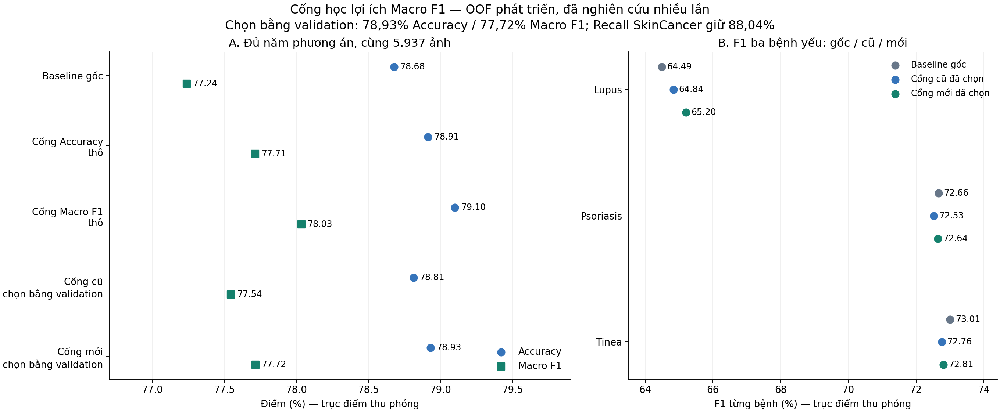
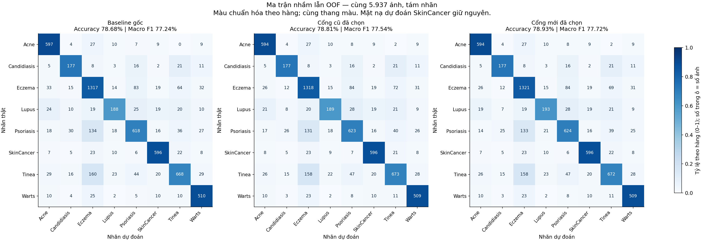

# Thử cổng học lợi ích Macro F1 — tám bệnh gốc

**Kết quả phát triển đã chọn bằng validation:** Accuracy **78,93%**, Macro F1 **77,72%**, Recall SkinCancer **88,04%**. Đúng 4686/5.937 ảnh, hơn cổng đã chọn trước **7 ảnh**, hơn baseline gốc **15 ảnh**.

**Chưa đủ để kết luận mọi bệnh đều tốt hơn:** F1 Psoriasis/Tinea vẫn thấp hơn baseline gốc; Recall Tinea giảm một ảnh so với cổng cũ. Điểm này là nghiên cứu OOF phát triển, không phải điểm của API. Baseline tham chiếu và API EfficientNet-B0 đơn giữ nguyên.

## 1. Thay đổi gì trong lượt này?

Cổng trước học phân biệt “đổi sang stack sẽ sửa đúng” với “đổi sẽ làm sai”. Cổng mới học xem **một lần đổi nhãn sẽ làm Macro F1 tăng hay giảm bao nhiêu** trên chính phần dữ liệu dành để fit cổng. Nhờ vậy, một ảnh vốn đoán sai và sau khi đổi vẫn sai cũng có thể cung cấp thông tin: nhãn dự đoán sai mới làm precision của các bệnh thay đổi. Không gọi các lần đó là ảnh được sửa đúng.

- Giữ ba backbone EfficientNet-B0, ConvNeXt-Tiny, ResNet50; không thêm backbone, không train lại CNN hoặc stack.
- Tái dùng cache ứng viên đã kiểm chứng: ba phần inner kiểm tra chéo theo nhóm; bên trong mỗi phần fit có hai phần kiểm tra chéo để tạo điểm ứng viên cho cổng.
- Fit **20 cổng đối chứng + 20 cổng Macro F1**; đối chứng tái lập đúng cổng Accuracy cũ. Không có fallback trong cả hai nhánh.
- Cùng 22 đặc trưng chỉ từ đầu ra model, cùng scaler fit trên những hàng sửa/hại của đối chứng, L2 `C=0.1`, ngưỡng chuyển cố định **score > 2/3**; bằng ngưỡng thì giữ baseline.
- Trọng số nhánh mới tỷ lệ với trị tuyệt đối lợi ích Macro F1. **Tổng trọng số bằng số hàng sửa/hại của đối chứng**, giữ tổng khối lượng loss ở cùng C; không ép trung bình trọng số thành 1 khi số hàng khác nhau.
- Chỉ phần fit cung cấp nhãn và ma trận để tạo lợi ích. Nhóm đang chấm, outer và nguồn khác không tạo mục tiêu hay trọng số cổng. Cổng cuối dùng điểm ứng viên OOF của toàn inner, không dùng điểm stack fit ngay trên chính ảnh đó.

Lợi ích là thay đổi chính xác của **một lần đổi** trên ma trận baseline của phần fit, cố định tám lớp. Dấu dương tạo nhãn 1, dấu âm tạo nhãn 0; sai khác không vượt `1e-12` bị bỏ. Khi nhiều ảnh cùng đổi, các lợi ích riêng không cộng tuyến tính: đây là hàm mục tiêu cục bộ, không bảo đảm tối ưu Macro F1 toàn cục.

## 2. So sánh đủ năm phương án trên cùng 5.937 ảnh

| Phương án | Accuracy | Macro F1 | Recall SkinCancer | Ảnh đúng | Sửa đúng / làm sai / sai→sai |
|---|---:|---:|---:|---:|---:|
| Baseline gốc | 78,68% | 77,24% | 88,04% | 4671 | 0 / 0 / 0 |
| Cổng Accuracy — thô | 78,91% | 77,71% | 88,04% | 4685 | 36 / 22 / 32 |
| Cổng Macro F1 — thô | 79,10% | 78,03% | 88,04% | 4696 | 44 / 19 / 44 |
| Cổng cũ — chọn bằng validation | 78,81% | 77,54% | 88,04% | 4679 | 24 / 16 / 25 |
| Cổng mới — chọn bằng validation | 78,93% | 77,72% | 88,04% | 4686 | 27 / 12 / 27 |

“Thô” là áp dụng cổng đó cho cả năm fold để nghiên cứu, chưa lọc bằng điều kiện validation. Không lấy điểm outer thuận lợi của nhánh thô để thay công thức đã khóa. “Chọn bằng validation” dùng cổng Macro F1 tại fold 0 và 3, giữ baseline tại fold 1, 2 và 4. Các lựa chọn đã khóa trước lượt chấm outer.

So với cổng đã chọn trước: Accuracy **+0,1179 điểm %**, Macro F1 **+0,1700 điểm %**. So với baseline gốc: tương ứng **+0,2527** và **+0,4773 điểm %**.

## 3. Precision / Recall / F1 từng bệnh

Mỗi ô dưới đây có thứ tự **Precision / Recall / F1**, đơn vị %. Cột số ảnh là số nhãn thật.

| Bệnh | Ảnh | Baseline gốc P / R / F1 | Cổng cũ đã chọn P / R / F1 | Cổng mới đã chọn P / R / F1 |
|---|---:|---:|---:|---:|
| Acne | 663 | 82,57% / 90,05% / 86,15% | 84,02% / 89,59% / 86,72% | 84,74% / 89,59% / 87,10% |
| Candidiasis | 243 | 67,82% / 72,84% / 70,24% | 70,80% / 72,84% / 71,81% | 71,37% / 72,84% / 72,10% |
| Eczema | 1577 | 76,88% / 83,51% / 80,06% | 77,17% / 83,58% / 80,24% | 77,16% / 83,77% / 80,33% |
| Lupus | 315 | 70,15% / 59,68% / 64,49% | 70,52% / 60,00% / 64,84% | 69,68% / 61,27% / 65,20% |
| Psoriasis | 897 | 76,87% / 68,90% / 72,66% | 75,88% / 69,45% / 72,53% | 76,00% / 69,57% / 72,64% |
| SkinCancer | 677 | 86,25% / 88,04% / 87,13% | 86,25% / 88,04% / 87,13% | 86,25% / 88,04% / 87,13% |
| Tinea | 989 | 79,43% / 67,54% / 73,01% | 78,16% / 68,05% / 72,76% | 78,41% / 67,95% / 72,81% |
| Warts | 576 | 80,19% / 88,54% / 84,16% | 80,67% / 88,37% / 84,34% | 80,79% / 88,37% / 84,41% |

**Ba bệnh ưu tiên:** F1 Lupus/Psoriasis/Tinea đều tăng so với cổng cũ đã chọn. Tuy nhiên, so với baseline gốc, Psoriasis F1 vẫn giảm khoảng 0,0205 điểm %, Tinea F1 giảm khoảng 0,1994 điểm %. Recall Tinea từ 68,0485% còn 67,9474%, tương ứng 673 xuống 672 ảnh đúng trong 989 ảnh. Lupus SCIN vẫn 0/11; chưa giải quyết được điểm yếu nguồn này.

**SkinCancer:** giữ đúng toàn bộ mặt nạ dự đoán nhị phân, nên recall/precision không đổi, đồng thời giữ các lỗi cancer hiện có. Đây là chỉ số theo nhãn dữ liệu của đề tài, không là xác nhận chẩn đoán lâm sàng.

## 4. Lựa chọn bằng validation, không chọn theo outer

| Fold | Giữ phương án | Validation Acc / MF1: baseline | Validation Acc / MF1: đối chứng | Validation Acc / MF1: Macro F1 | Lý do nhánh Macro F1 chưa được chọn |
|---|---|---:|---:|---:|---|
| 0 | macro_f1_gate | 77,72% / 76,66% | 77,72% / 76,70% | 77,72% / 76,82% | Đạt, được chọn |
| 1 | current_fusion | 81,91% / 82,06% | 81,91% / 82,06% | 81,91% / 82,06% | macro_f1_below_control, mean_focus_f1_below_control |
| 2 | current_fusion | 76,79% / 76,57% | 76,37% / 76,11% | 76,79% / 76,38% | Lupus_f1, Lupus_recall, Psoriasis_f1, Psoriasis_recall, macro_f1, precision_Lupus, precision_Psoriasis |
| 3 | macro_f1_gate | 79,35% / 77,97% | 79,63% / 78,57% | 79,78% / 78,89% | Đạt, được chọn |
| 4 | current_fusion | 83,24% / 83,68% | 83,10% / 83,37% | 83,10% / 83,43% | Lupus_f1, Psoriasis_f1, Tinea_f1, accuracy, macro_f1, precision_Lupus, precision_Tinea, recall_Candidiasis, mean_focus_f1_below_control |

Điều kiện baseline giữ Accuracy/Macro F1, Recall/F1 từng bệnh Lupus/Psoriasis/Tinea, giới hạn giảm precision/recall còn lại và giữ cancer. Nhánh mới còn phải không thấp hơn đối chứng về Accuracy, Macro F1 và F1 trung bình ba bệnh yếu. Các mã trên tương ứng bệnh/chỉ số không đạt; `below_control` là thấp hơn đối chứng. Không nới điều kiện sau khi thấy outer.

### Outer từng fold — thông tin mô tả sau khi khóa

| Fold | Baseline Acc / MF1 | Cổng cũ đã chọn Acc / MF1 | Cổng mới đã chọn Acc / MF1 |
|---|---:|---:|---:|
| 0 | 78,32% / 76,94% | 78,74% / 78,18% | 78,91% / 78,21% |
| 1 | 77,62% / 76,55% | 77,62% / 76,55% | 77,62% / 76,55% |
| 2 | 80,85% / 80,83% | 80,85% / 80,83% | 80,85% / 80,83% |
| 3 | 77,85% / 75,33% | 78,10% / 75,72% | 78,52% / 76,53% |
| 4 | 78,73% / 76,23% | 78,73% / 76,23% | 78,73% / 76,23% |

## 5. Bao nhiêu hàng thực sự học mục tiêu mới?

Đây là số hàng trong các phần fit cổng, không phải số ảnh mới. Các phần fit có thể lặp ảnh giữa các lượt; không cộng chúng thành số ảnh độc lập. Nhãn 0/1 là làm giảm/tăng lợi ích Macro F1 cục bộ, không là nhãn bệnh.

| Fold / phần fit | Hàng đối chứng sửa/hại | Hàng utility | Utility nhãn 0 / 1 | Sai→sai được học | Tổng trọng số utility | Trọng số min / max |
|---|---:|---:|---:|---:|---:|---:|
| 0 / meta 0 | 35 | 56 | 23 / 33 | 21 | 35.0000 | 0.016137 / 1.954711 |
| 0 / meta 1 | 40 | 52 | 27 / 25 | 12 | 40.0000 | 0.083976 / 1.845800 |
| 0 / meta 2 | 47 | 66 | 32 / 34 | 19 | 47.0000 | 0.012635 / 1.548189 |
| 0 / final | 48 | 76 | 25 / 51 | 28 | 48.0000 | 0.001183 / 1.568397 |
| 1 / meta 0 | 23 | 31 | 19 / 12 | 8 | 23.0000 | 0.001745 / 2.247868 |
| 1 / meta 1 | 23 | 31 | 15 / 16 | 8 | 23.0000 | 0.039305 / 1.806444 |
| 1 / meta 2 | 25 | 43 | 24 / 19 | 18 | 25.0000 | 0.020110 / 1.726623 |
| 1 / final | 34 | 47 | 22 / 25 | 13 | 34.0000 | 0.023613 / 1.803905 |
| 2 / meta 0 | 47 | 63 | 31 / 32 | 16 | 47.0000 | 0.037454 / 2.212771 |
| 2 / meta 1 | 61 | 72 | 38 / 34 | 11 | 61.0000 | 0.040949 / 2.250755 |
| 2 / meta 2 | 38 | 50 | 20 / 30 | 12 | 38.0000 | 0.099511 / 1.778562 |
| 2 / final | 58 | 80 | 40 / 40 | 22 | 58.0000 | 0.028709 / 2.214072 |
| 3 / meta 0 | 33 | 51 | 28 / 23 | 18 | 33.0000 | 0.019985 / 1.905588 |
| 3 / meta 1 | 28 | 40 | 21 / 19 | 12 | 28.0000 | 0.052678 / 2.000959 |
| 3 / meta 2 | 41 | 58 | 27 / 31 | 17 | 41.0000 | 0.005055 / 2.210881 |
| 3 / final | 55 | 76 | 37 / 39 | 21 | 55.0000 | 0.042507 / 2.075471 |
| 4 / meta 0 | 31 | 47 | 23 / 24 | 16 | 31.0000 | 0.018853 / 1.541415 |
| 4 / meta 1 | 28 | 39 | 22 / 17 | 11 | 28.0000 | 0.097929 / 1.977660 |
| 4 / meta 2 | 33 | 47 | 20 / 27 | 14 | 33.0000 | 0.029410 / 2.057620 |
| 4 / final | 41 | 65 | 32 / 33 | 24 | 41.0000 | 0.021923 / 2.079041 |

## 6. Phân nguồn trong cohort phát triển

| Nguồn | Ảnh | Baseline Acc / MF1 | Cổng cũ đã chọn Acc / MF1 | Cổng mới đã chọn Acc / MF1 |
|---|---:|---:|---:|---:|
| original_train | 4961 | 80,29% / 79,31% | 80,41% / 79,59% | 80,51% / 79,75% |
| SCIN | 976 | 70,49% / 30,71% | 70,70% / 30,42% | 70,90% / 30,61% |

Macro F1 SCIN tăng so với cổng cũ nhưng vẫn thấp hơn baseline gốc. SCIN có 645 ảnh Eczema trong 976 ảnh, chỉ 11 Lupus và không có nhãn thật SkinCancer; Accuracy tổng có thể che bệnh ít ảnh. Macro F1 ở đây vẫn trung bình cố định tám nhãn. Không dùng SCIN để chứng minh Recall SkinCancer.

## 7. Khoảng tin cậy và phạm vi kết luận

| Phương án | Chênh Accuracy so gốc, CI 95% (điểm %) | Chênh MF1 so gốc, CI 95% (điểm %) | Chênh Accuracy so cổng cũ, CI 95% | Chênh MF1 so cổng cũ, CI 95% |
|---|---:|---:|---:|---:|
| Baseline gốc | [+0,0000; +0,0000] | [+0,0000; +0,0000] | [-0,3398; +0,0672] | [-0,5513; -0,0672] |
| Cổng Accuracy — thô | [+0,0000; +0,4773] | [+0,2040; +0,7525] | [-0,0333; +0,2360] | [+0,0362; +0,3206] |
| Cổng Macro F1 — thô | [+0,1684; +0,6878] | [+0,4806; +1,1254] | [+0,1000; +0,4911] | [+0,2429; +0,7603] |
| Cổng cũ — chọn bằng validation | [-0,0672; +0,3398] | [+0,0672; +0,5513] | [+0,0000; +0,0000] | [+0,0000; +0,0000] |
| Cổng mới — chọn bằng validation | [+0,0504; +0,4673] | [+0,2444; +0,7598] | [+0,0168; +0,2364] | [+0,0112; +0,3600] |

CI dùng 1.000 lượt bootstrap ghép cặp theo nhóm ảnh/ca, trên cùng dự đoán đã fit. Đây là khoảng có điều kiện của thử nghiệm này; chưa điều chỉnh việc đã thử nhiều phương pháp, không bao gồm bất định của nhiều seed huấn luyện, và không biến dữ liệu đã nghiên cứu thành test độc lập. Các fold dùng nguồn train chồng nhau; mã nhóm chưa là ID bệnh nhân được xác nhận. CNN/ trọng số baseline từng dùng cả inner để chọn từ trước; meta kiểm tra chéo không xóa lịch sử đó.

## 8. Kiểm chứng và tài liệu tham khảo

- Kiểm chứng độc lập **PASS**: tái fit 20 cổng đối chứng + 20 cổng utility; sai khác tham số đối chứng 0, utility tối đa 1,432×10⁻¹³.
- Dựng lại năm lựa chọn, 5.937 dự đoán, 55 bộ chỉ số, 50 lượt đối chiếu đầu ứng viên đã cache; kiểm tra nhóm, scaler dùng chung, tổng trọng số và phép thay từng ô ma trận.
- Bộ kiểm thử toàn dự án **175/175 PASS trong 15,15 giây**. PASS xác nhận phép tính/provenance/triển khai, không là chứng nhận lâm sàng.
- Mượn ý tưởng tối ưu F-measure bằng mục tiêu có chi phí từ [Parambath và cộng sự, 2014](https://proceedings.neurips.cc/paper_files/paper/2014/hash/5c0314ec1b57fcd36bbb013f3f025868-Abstract.html) và học tối ưu chỉ số không tách riêng từng ảnh từ [Narasimhan và cộng sự, 2015](https://proceedings.mlr.press/v37/narasimhanb15.html). Không tuyên bố tái lập thuật toán, kết quả hoặc bảo đảm tối ưu của các bài báo.

[Protocol đã khóa](protocol.json) · [Kết quả chi tiết](results.json) · [Kiểm chứng độc lập](independent_review.json) · [Lựa chọn cả năm fold](all_selections_locked.json)

## 9. Kiểm tra chuyển nguồn bằng mô hình đã khóa

Không fit hoặc chọn ngưỡng theo các nguồn này. Mỗi bộ ảnh được chấm bằng **cùng năm hệ thống theo fold**; bảng là trung bình số học của năm chỉ số, không phải một bộ gộp mới, năm nguồn độc lập hay năm seed. Các nguồn đã có lịch sử nghiên cứu, không phải bộ test lâm sàng mới. Không tính thêm khoảng tin cậy trong kiểm tra con.

| Nguồn / vai trò lịch sử | Ảnh | Baseline Acc / MF1 | Cổng cũ đã chọn Acc / MF1 | Cổng mới đã chọn Acc / MF1 |
|---|---:|---:|---:|---:|
| DermaCon toàn bộ | 986 | 39,03% / 34,16% | 38,82% / 34,10% | 38,74% / 33,89% |
| DermaCon train phụ lịch sử | 590 | 37,32% / 30,00% | 37,05% / 29,81% | 36,88% / 29,61% |
| DermaCon validation lịch sử | 213 | 44,32% / 41,79% | 44,32% / 41,92% | 44,32% / 41,74% |
| DermaCon test lịch sử | 183 | 38,36% / 32,07% | 38,14% / 31,95% | 38,25% / 31,90% |
| SkinDisNet, Eczema/Tinea | 723 | 22,30% / 6,91% | 22,57% / 7,04% | 22,66% / 7,07% |

MF1 trong bảng giữ cố định **tám nhãn**. DermaCon test 183 ảnh không có Lupus; SkinDisNet chỉ có Eczema/Tinea. F1 trung bình trên hai lớp có ảnh thật của SkinDisNet lần lượt là **27,64% / 28,14% / 28,28%** (gốc / cũ / mới); không coi đó là đánh giá đủ tám bệnh. 986 đã gồm 590 + 213 + 183; không cộng lại các phần trùng nhau.

**Khả năng chuyển nguồn còn chưa ổn định:** DermaCon toàn bộ giảm nhẹ Accuracy/Macro F1 so với cổng cũ; test lịch sử 183 ảnh có Accuracy tăng nhưng Macro F1 giảm. SkinDisNet tăng nhẹ. Không dùng điểm thuận lợi của một nguồn để thay lựa chọn đã khóa.

[Protocol nguồn](transfer_check/protocol.json) · [Biên nhận kiểm chứng nguồn](transfer_check/independent_review.json)

## Kết luận để trình bày

“Nhóm giữ ba model hiện có, đổi cách học cổng sang lợi ích Macro F1 và so với cổng cũ trong cùng điều kiện. Bản chọn bằng validation tăng thêm bảy ảnh đúng, Macro F1 tăng khoảng 0,17 điểm %, giữ Recall SkinCancer. Tuy nhiên Tinea còn mất một ảnh đúng so với cổng cũ, F1 Psoriasis/Tinea chưa vượt baseline gốc và SCIN vẫn yếu. Vì vậy đây là cải thiện thăm dò trên dữ liệu phát triển, chưa gọi là tối ưu ổn định hoặc áp dụng lâm sàng.”
