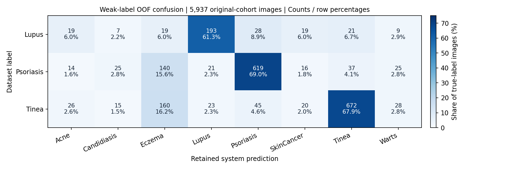

# Phân tích lỗi ba bệnh yếu — 24/10/2026

Đây là **phân tích kết quả đã có**, chưa train model mới. Dùng bản nghiên cứu tám nhóm đang giữ, OOF 5.937 ảnh. Điểm tổng vẫn **78,95% Accuracy / 77,73% Macro F1 / 88,04% Recall SkinCancer**. API vẫn dùng B0 đơn.

## 1. Các lỗi tập trung ở đâu?

| Nhãn dataset | Đúng / tổng | Precision | Recall | F1 | Ba nhãn hay đoán nhầm nhất (số ảnh) |
|---|---:|---:|---:|---:|---|
| Lupus | 193/315 | 69.93% | 61.27% | 65.31% | Psoriasis: 28, Tinea: 21, Eczema: 19 |
| Psoriasis | 619/897 | 76.42% | 69.01% | 72.52% | Eczema: 140, Tinea: 37, Candidiasis: 25 |
| Tinea | 672/989 | 78.69% | 67.95% | 72.92% | Eczema: 160, Psoriasis: 45, Warts: 28 |

Psoriasis và Tinea bị đoán sang Eczema lần lượt **140 và 160 ảnh**, chiếm khoảng một nửa số lỗi của mỗi bệnh. Lupus có lỗi phân tán qua nhiều nhãn; bộ phân biệt Lupus với chỉ một bệnh có thể bỏ qua nhiều lỗi khác.

| AI gọi nhãn | Số ảnh thuộc nhãn khác bị gọi nhầm | Ba nhãn thật đóng góp nhiều nhất |
|---|---:|---|
| Lupus | 83 | Tinea: 23, Psoriasis: 21, Eczema: 14 |
| Psoriasis | 191 | Eczema: 80, Tinea: 45, Lupus: 28 |
| Tinea | 182 | Eczema: 68, Psoriasis: 37, SkinCancer: 22 |

Precision theo dõi chiều gọi nhầm vào bệnh; Recall theo dõi chiều bỏ sót bệnh. Chỉ đổi dự đoán Eczema sang Psoriasis/Tinea có thể sửa một số lỗi nhưng cũng tạo thêm gọi nhầm; cần kiểm tra cả hai chiều.

## 2. Chênh lệch nguồn ảnh lớn

| Bệnh | Nguồn cũ: đúng/tổng (Recall) | SCIN: đúng/tổng (Recall) | Nhóm nguồn cũ / SCIN |
|---|---:|---:|---:|
| Lupus | 193/304 (63.49%) | 0/11 (0.00%) | 293 / 6 |
| Psoriasis | 583/790 (73.80%) | 36/107 (33.64%) | 771 / 52 |
| Tinea | 657/886 (74.15%) | 15/103 (14.56%) | 864 / 49 |

**SCIN Lupus chỉ có 11 ảnh thuộc sáu nhóm ca/cảnh; không phải 11 bệnh nhân độc lập đã xác thực.** Cả 11 ảnh đều sai OOF; tám ảnh bị gọi Eczema. Đây là dấu hiệu yếu trên nguồn này, chưa chứng minh nguyên nhân là ánh sáng, loại ảnh, nhãn sai hay bản thân bệnh.

SCIN đã nằm trong cohort phát triển. Bảng này phản ánh chênh lệch giữa các nguồn trong OOF, **không phải kiểm chứng trên một bộ bệnh nhân mới**. SCIN không có nhãn SkinCancer trong cohort này; không suy ra khả năng nhận ung thư trên SCIN.

### Nhãn nguồn có điều gì cần lưu ý?

Tái sử dụng inventory đã kiểm chứng ngày 21/10 và đối chiếu đủ 5.937 path/SHA/nhãn/group/nguồn với bản hiện tại. Nhãn SCIN được chọn từ các gợi ý chẩn đoán hồi cứu trong metadata; không phải nhãn mới được bác sĩ nhóm xác nhận. Mã chuẩn bị dữ liệu chỉ ánh xạ `Cutaneous lupus → Lupus`, `Psoriasis → Psoriasis`, `Tinea → Tinea`. DermaCon ánh xạ `Discoid Lupus Erythematosus → Lupus`, `Tinea Corporis → Tinea`; không coi các định nghĩa nguồn là hoàn toàn giống nhau.

| Nhãn SCIN | Có nhãn gợi ý đồng hạng cao nhất | Có Eczema trong danh sách gợi ý | Đoán Eczema / trong đó nguồn cũng có gợi ý Eczema |
|---|---:|---:|---:|
| Lupus | 0/11 | 0/11 | 8 / 0 |
| Psoriasis | 19/107 | 49/107 | 48 / 25 |
| Tinea | 13/103 | 56/103 | 60 / 33 |

Không có cờ ánh xạ sai alias trong ba nhóm SCIN của inventory cũ. Điều này chỉ kiểm tra quy tắc tên nhãn, không xác nhận chẩn đoán. Trọng số gợi ý không phải xác suất bệnh đã hiệu chỉnh. Có Eczema trong gợi ý không biến dự đoán sai thành đúng: điểm vẫn chấm theo nhãn cứng gốc. Lupus không có nhãn đồng hạng hoặc Eczema trong gợi ý, nên không dùng sự nhập nhằng này để giải thích cả 11 lỗi Lupus.

## 3. Có phải bị khóa SkinCancer nên không cải thiện được?

| Bệnh | Tổng lỗi | Đang được phép đổi trong specialist bốn nhóm | Bị khóa do dự đoán SkinCancer | Ngoài phạm vi, không phải Cancer |
|---|---:|---:|---:|---:|
| Lupus | 122 | 68 | 19 | 35 |
| Psoriasis | 278 | 198 | 16 | 64 |
| Tinea | 317 | 228 | 20 | 69 |

Phạm vi hiện tại chỉ cho phép đổi khi dự đoán đang là Lupus/Psoriasis/Tinea/Eczema. **55 trong tổng 717 lỗi** ba bệnh bị giữ ở SkinCancer, nên khóa này chưa giải thích phần lớn số lỗi. Giữ nguyên mask bảo toàn cả Recall/Precision Cancer lẫn các lỗi Cancer cũ. Nới phạm vi có thể tạo thêm lỗi, chưa có bằng chứng đó là giải pháp.

## 4. Độ ổn định giữa năm fold

| Bệnh | Recall fold 0 | Fold 1 | Fold 2 | Fold 3 | Fold 4 |
|---|---:|---:|---:|---:|---:|
| Lupus | 57.53% (42/73) | 59.65% (34/57) | 70.00% (42/60) | 65.52% (38/58) | 55.22% (37/67) |
| Psoriasis | 71.72% (104/145) | 69.61% (126/181) | 65.48% (129/197) | 66.11% (119/180) | 72.68% (141/194) |
| Tinea | 67.60% (121/179) | 66.51% (139/209) | 68.88% (135/196) | 67.15% (139/207) | 69.70% (138/198) |

Năm fold không phải năm seed độc lập. OOF gộp mỗi ảnh đúng một lần; không lấy trung bình không trọng số của Recall các fold để thay điểm tổng.

## 5. Các nguồn khác đã xem trước đây

| Nguồn / vai trò | Bệnh | Ảnh / nhóm | Recall của 5 hệ thống: trung bình [min–max] |
|---|---|---:|---:|
| dermacon_all | Lupus | 11 / 4 | 16.36% [9.09%–27.27%] |
| dermacon_all | Psoriasis | 154 / 70 | 72.34% [64.94%–77.92%] |
| dermacon_all | Tinea | 319 / 242 | 8.53% [4.39%–14.42%] |
| dermacon_historical_aux_train | Lupus | 6 / 2 | 16.67% [0.00%–33.33%] |
| dermacon_historical_aux_train | Psoriasis | 92 / 38 | 71.74% [65.22%–77.17%] |
| dermacon_historical_aux_train | Tinea | 200 / 152 | 9.00% [4.00%–16.00%] |
| dermacon_historical_validation | Lupus | 5 / 2 | 16.00% [0.00%–20.00%] |
| dermacon_historical_validation | Psoriasis | 29 / 13 | 76.55% [65.52%–82.76%] |
| dermacon_historical_validation | Tinea | 69 / 49 | 4.93% [1.45%–10.14%] |
| dermacon_historical_official_test | Lupus | 0 / 0 | Không có ảnh |
| dermacon_historical_official_test | Psoriasis | 33 / 19 | 70.30% [57.58%–78.79%] |
| dermacon_historical_official_test | Tinea | 50 / 41 | 11.60% [8.00%–18.00%] |
| skindisnet_transfer | Lupus | 0 / 0 | Không có ảnh |
| skindisnet_transfer | Psoriasis | 0 / 0 | Không có ảnh |
| skindisnet_transfer | Tinea | 265 / 68 | 13.06% [8.30%–18.49%] |

Cùng ảnh được chấm bởi năm hệ thống fold, không nhân số ảnh lên năm lần. DermaCon toàn bộ 986 ảnh bao gồm các vai trò 590/213/183, không cộng chồng các hàng. SkinDisNet chỉ có Eczema/Tinea; thiếu Lupus/Psoriasis không được tính thành Recall 0%. Các nguồn này đã được xem qua nhiều thí nghiệm, không còn là test xác nhận độc lập.

## 6. Đã chuẩn bị gì để rà dữ liệu?

- Kiểm SHA và khả năng mở ảnh của **1533 ảnh mang ba nhãn yếu trong train fold 0**; giữ nguyên nhãn.
- Thống kê số ảnh và nhóm ca/cảnh theo bệnh, nguồn và vai trò train/inner/outer cho cả năm fold.
- Liệt kê toàn bộ **717 lỗi OOF** cùng nhãn nguồn, dự đoán, fold, group và phạm vi định tuyến.
- Tạo danh sách rà ảnh **chỉ từ train fold 0**: tối đa năm nhóm/bệnh/nguồn, ưu tiên cạnh ảnh nhỏ rồi thứ tự đường dẫn. Chưa có ai xác nhận lại nhãn.
- Gắn cờ cạnh ảnh dưới 224 pixel để người rà biết ảnh phải phóng lớn; không kết luận ảnh không dùng được. Nhóm có nhiều nhãn cũng chỉ là cờ cần kiểm tra, không tự gán là nhãn sai.

[Danh sách rà ảnh train](training_review.md) · [Toàn bộ lỗi OOF](oof_weak_errors.json) · [Thống kê chi tiết](results.json) · [Nhóm train có nhiều nhãn](mixed_label_training_groups.json)

## 7. Quyết định cho bước tiếp theo

1. **Ưu tiên xác minh độ phủ và cách gán nhãn theo nguồn của ba bệnh**, đặc biệt SCIN Lupus. Bảng hiện tại cho thấy chênh lệch nguồn, chưa xác định nguyên nhân. Nếu không có người chuyên môn, giữ cờ chưa xác minh và không tự sửa nhãn bằng model.
2. **Psoriasis–Eczema và Tinea–Eczema là hai cặp cần phân tích trước**. Các binary specialist, class-balanced pairs và Focal đã thử chưa vượt điều kiện validation; bảng lỗi này chưa đủ lý do để train lại y nguyên.
3. Chỉ mở thí nghiệm tiếp khi có thay đổi cụ thể về dữ liệu hoặc giả thuyết. Đăng ký thay đổi, cách chia nhóm và điều kiện chọn trước khi chạy. Do đã đọc outer nhiều lần, cần một tập mới được giữ kín để xác nhận cải thiện; không gọi điểm trên cohort hiện tại là test độc lập.

**Chưa thay checkpoint, ngưỡng, nhãn, API hoặc điểm nghiên cứu.** Báo cáo này giúp chọn việc cần làm dựa trên lỗi thực tế; không chứng minh chất lượng chẩn đoán lâm sàng.
