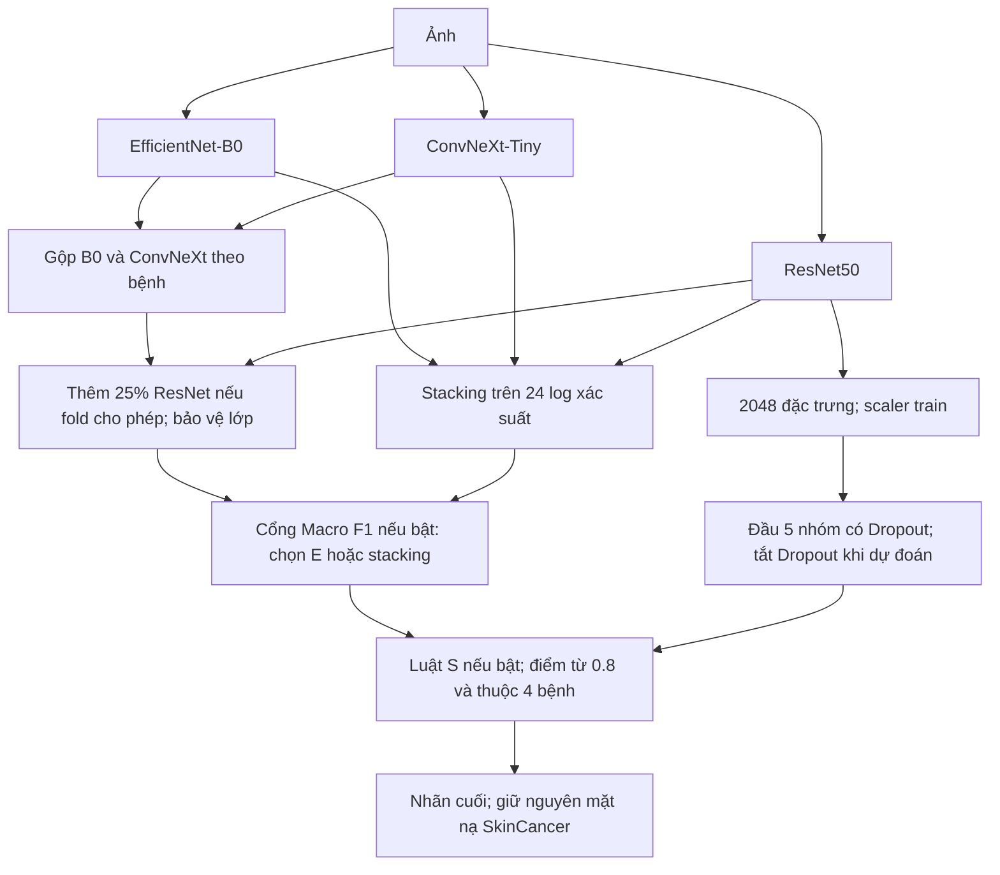

# Giải trình ensemble, specialist và bộ chọn dự đoán

Ngày đối chiếu mã nguồn và tính lại bảng thành phần: **08/11/2026**.

**Cập nhật sau khi tích hợp:** mô tả API B0 bên dưới là trạng thái tại lúc giải trình.
API hiện được cấu hình dùng bản E/G/S năm fold; quy tắc phục vụ ảnh mới,
ý nghĩa mức đồng thuận và kết quả kiểm chứng nằm trong [bản tích hợp](AP_DUNG_PIPELINE_AI_20261108.md).

Tài liệu trả lời năm câu hỏi của thầy bằng cơ chế có trong mã và dự đoán đã lưu. **Bản nghiên cứu tham chiếu đang giữ là 4.687/5.937 ảnh đúng, Accuracy 78,9456%, Macro F1 77,7287%, Recall SkinCancer 88,0355%. API hiện vẫn dùng EfficientNet-B0 đơn; chưa triển khai pipeline dưới đây vào API.** Cấu hình theo fold phục vụ đánh giá OOF, chưa phải một cấu hình phục vụ ảnh mới đã đóng gói.

## 1. Ba backbone được kết hợp như thế nào?

Có hai đường tạo dự đoán, dùng lại cùng ba CNN.

### Đường ensemble tham chiếu E

**Bước 1 — B0 và ConvNeXt dùng trọng số riêng theo bệnh và theo fold.** Với bệnh c:

```text
u[c] = (1 - w[c]) × p_B0[c] + w[c] × p_ConvNeXt[c]
p_BC = u / tổng(u)
```

Trọng số ConvNeXt `w[c]` chỉ nhận 0,25; 0,50; 0,75. Chọn bằng **inner validation của chính fold**, theo quy tắc đặt trước:

- Đếm A: ảnh mang nhãn c chỉ B0 đoán đúng; B: ảnh mang nhãn c chỉ ConvNeXt đoán đúng.
- Ngưỡng lợi thế `t = max(3, ceil(0,05 × số ảnh nhãn c trên inner validation))`.
- Nếu B−A ≥ t: dùng 75% ConvNeXt, 25% B0.
- Nếu B−A ≤ −t: dùng 25% ConvNeXt, 75% B0.
- Các trường hợp còn lại: 50%–50%.

Đây là lựa chọn rời rạc bằng validation, không phải học tám trọng số liên tục bằng gradient hoặc chọn model theo nhãn thật của ảnh đang dự đoán.

Trọng số **ConvNeXt** thực tế; trọng số B0 bằng 1 trừ ô tương ứng:

| Fold, chỉ số mã 0–4 | Acne | Candidiasis | Eczema | Lupus | Psoriasis | SkinCancer | Tinea | Warts |
|---|---:|---:|---:|---:|---:|---:|---:|---:|
| 0 | 0,50 | 0,75 | 0,50 | 0,50 | 0,50 | 0,50 | 0,75 | 0,75 |
| 1 | 0,75 | 0,75 | 0,75 | 0,75 | 0,25 | 0,75 | 0,75 | 0,75 |
| 2 | 0,50 | 0,50 | 0,50 | 0,50 | 0,50 | 0,75 | 0,75 | 0,75 |
| 3 | 0,50 | 0,50 | 0,75 | 0,50 | 0,50 | 0,75 | 0,75 | 0,75 |
| 4 | 0,75 | 0,75 | 0,50 | 0,75 | 0,50 | 0,75 | 0,75 | 0,75 |

**Bước 2 — bổ sung ResNet bằng tỷ trọng cố định:**

```text
điểm_gộp[c] = 0,75 × p_BC[c] + 0,25 × p_ResNet[c]
```

Tỷ lệ 75:25 là công thức thử đã cố định. Inner validation quyết định nhánh này có được dùng và lớp nào cần bảo vệ; không học một bộ ba trọng số tự do cho từng ảnh. Ảnh đang được p_BC gọi vào lớp bảo vệ giữ nguyên nhãn; các ảnh còn lại chỉ được chọn trong các lớp không bảo vệ. Nếu nhánh không đạt điều kiện, fold đó dùng p_BC.

| Fold | Đường E được giữ | Các lớp giữ nguyên mặt nạ dự đoán của p_BC tại lớp fusion |
|---|---|---|
| 0 | Gộp ResNet 25% có bảo vệ | Candidiasis, Lupus, SkinCancer |
| 1 | Gộp ResNet 25% có bảo vệ | Candidiasis, SkinCancer |
| 2 | Quay về p_BC | Tất cả tám lớp |
| 3 | Gộp ResNet 25% có bảo vệ | Candidiasis, SkinCancer |
| 4 | Gộp ResNet 25% có bảo vệ | Candidiasis, SkinCancer |

Các khóa thêm ngoài SkinCancer thuộc lớp fusion. Các thành phần sau có luật riêng; không tuyên bố mọi lớp bảo vệ này đều bị khóa xuyên suốt toàn pipeline.

### Đường stacking tạo ứng viên cho bộ chọn G

Stacking lấy **24 đầu vào = log xác suất của ba CNN × tám bệnh**, chuẩn hóa bằng scaler của phần fit rồi học Logistic Regression đa lớp, L2, C=0,1. Nó tạo phân bố tám lớp khác với đường E. Các hệ số được học từ dự đoán trong inner validation, có chia nhóm để tạo đầu ra ngoài phần fit cho tầng cổng.

Đây là một đầu gộp được học từ đầu ra ba CNN, khác với specialist đọc đặc trưng ảnh. Các hệ số stacking không phải ba trọng số phần trăm đơn giản. Khi định tuyến, ảnh E đang gọi SkinCancer được giữ; ảnh khác chỉ lấy ứng viên stacking trong bảy lớp còn lại.

Nguồn mã: [trọng số theo bệnh](../ai-service/training/evaluate_scene_grouped_oof_classwise_fusion.py), [fusion có bảo vệ](../ai-service/training/evaluate_original_eight_cancer_locked_fusion.py), [stacking](../ai-service/training/run_teacher_logprob_stacking.py).

## 2. Specialist hiện tại là gì? Đã có các cặp nào?

**Đầu specialist S có trong bản nghiên cứu đang giữ không phải một tập đầu cặp.** Nó đọc **2.048 đặc trưng ResNet50 đóng băng**, chuẩn hóa bằng thống kê train và đi qua:

```text
2048 → Linear 128 → ReLU → Dropout(0,5) → Linear 5 → Softmax
```

Năm nhóm nội bộ là **Lupus, Psoriasis, Tinea, Eczema, Other**. Other gom Acne/Candidiasis/SkinCancer/Warts trong mục tiêu học để đầu biết từ chối. Other không trở thành bệnh thứ chín trong đầu ra đồ án. Khi dự đoán Dropout tắt; chỉ đầu nhỏ được huấn luyện, không train lại CNN trong thử nghiệm này.

Huấn luyện đầu bằng CE năm nhóm, AdamW, tối đa cố định 20 epoch; checkpoint và việc có dùng đầu hay không được chọn bằng inner validation sau định tuyến đủ tám bệnh. Trong bản giữ, dùng đầu Dropout tại fold 1/2; không gắn đầu này ở mọi fold.

Các specialist cặp đã thử và có hồ sơ riêng:

| Cặp | Biểu diễn và cách học | Trạng thái so với bản OOF đang giữ |
|---|---|---|
| Lupus–Acne | Đặc trưng ResNet cố định, đầu logistic hai lớp; có thử cân loss | Pilot chưa đạt; chưa đưa vào bản giữ |
| Psoriasis–Eczema | Cùng thiết kế đầu cặp trên ResNet | Pilot chưa đạt; chưa đưa vào bản giữ |
| Tinea–Eczema | Cùng thiết kế đầu cặp trên ResNet | Pilot chưa đạt; chưa đưa vào bản giữ |
| Lupus–Psoriasis | Đặc trưng ConvNeXt ImageNet đóng băng, đầu logistic hai lớp | Có tăng cục bộ trên validation lịch sử; chưa đủ ổn định để thay bản giữ |
| Lupus–Tinea | Cùng thiết kế trên ConvNeXt; ghép với đầu Lupus–Psoriasis để đề xuất Lupus | Tương tự; không được tính vào điểm OOF tổng của bản giữ |

Hai đầu Lupus về sau còn có thử LDA xác nhận. Ngoài đầu cặp, nhóm đã thử CNN ConvNeXt chuyên biệt ba nhóm, có Other và các đầu nhiều nhóm hơn bằng fine-tune. Đây là các nhánh nghiên cứu khác, không được cộng tất cả vào pipeline cuối. Không lấy điểm trên 713/718/1.332 ảnh để thay điểm OOF 5.937 ảnh.

Nguồn: [đầu Dropout](../ai-service/reports/teacher_dropout_specialist_seed42_20261023/summary.md), [ba cặp trên ResNet](../ai-service/reports/teacher_pairwise_specialists_fold0_seed42_20261024/summary.md), [hai cặp Lupus](../ai-service/reports/teacher_lupus_coupled_pair_specialist_fold1_20261029/summary.md), [kiểm tra lặp](../ai-service/reports/teacher_lupus_coupled_pair_fold0_repeat_20261029/summary.md), [LDA xác nhận](../ai-service/reports/teacher_lupus_shrinkage_lda_confirmation_20261031/summary.md).

## 3. Khi nào dùng ensemble, khi nào dùng kết quả khác?

Có **hai quyết định khác nhau**:

1. **Trước khi chấm outer:** inner validation chọn thành phần nào được dùng ở từng fold. Lựa chọn được khóa trước lượt chấm outer tương ứng. Đây là lựa chọn cấu hình cho fold, không dùng nhãn thật của ảnh khi suy luận.
2. **Với từng ảnh:** cổng G quyết định E hay stacking; sau đó luật specialist S quyết định có thay nhãn hiện tại hay không, nếu thành phần đó được bật ở fold đang xét.

**Cổng G được học bằng Logistic Regression nhị phân, L2, C=0,1**, dùng 22 đặc trưng:

- Ba chênh lệch log xác suất “ứng viên stacking so với nhãn E”, một chênh cho mỗi backbone.
- Một chênh lệch tương tự từ đầu stacking.
- Một chênh lệch số phiếu của ba backbone và một entropy trung bình.
- One-hot nhãn E tám chiều và one-hot ứng viên tám chiều.

Mục tiêu của cổng đang giữ: trên phần fit, tính tác động Macro F1 nếu đổi riêng một dự đoán E sang ứng viên. Tác động dương/âm tạo nhãn lợi/hại; trị tuyệt đối tác động làm trọng số loss. Chỉ nhãn phần fit tạo mục tiêu. Dự đoán stacking dùng học cổng được tạo ngoài phần fit của stack bằng chia nhóm lồng; không lấy dự đoán stack đã fit ngay trên chính ảnh đó.

**Chấp nhận ứng viên khi điểm cổng > 2/3**, hai nhãn khác nhau và không đụng SkinCancer. Bằng ngưỡng thì giữ E. Đây là điểm phân biệt lợi/hại của phép đổi, không phải xác suất mắc bệnh hay confidence đã được hiệu chỉnh. Cổng này không dựa riêng vào Top-2 hoặc một luật “ensemble confidence thấp thì luôn chuyển”.

**Luật S:** chỉ xét khi nhãn hiện tại thuộc Lupus/Psoriasis/Tinea/Eczema. Lấy nhóm có điểm lớn nhất trong đầu năm nhóm. Nếu là một trong bốn bệnh và điểm ≥ 0,8 thì nhận nhãn đó; nếu Other hoặc dưới ngưỡng thì giữ nhãn trước. Ngưỡng 0,8 là luật cố định; điểm softmax này chưa là độ tin cậy lâm sàng đã hiệu chỉnh.

Nguồn: [22 đặc trưng và ngưỡng cổng](../ai-service/training/run_teacher_conservative_gate.py), [mục tiêu Macro F1](../ai-service/training/run_teacher_macro_f1_gate.py), [luật S](../ai-service/training/run_teacher_priorities_ensemble_specialist.py).

## 4. Khi specialist khác ensemble thì sao? Bảo vệ SkinCancer ra sao?

Nếu đủ điều kiện, **thay trực tiếp nhãn**, không lấy trung bình lại xác suất ensemble với specialist. Tương tự, G chọn nhãn E hay nhãn stacking. Vì thế chưa có một vector xác suất cuối đã hiệu chỉnh cho toàn chuỗi; không được gắn điểm softmax cũ với nhãn mới rồi gọi là confidence cuối.

Bảo vệ SkinCancer là **giữ nguyên toàn bộ mặt nạ dự đoán**, không chỉ kiểm tra recall sau cùng:

- p_BC đang dự đoán SkinCancer → fusion không đổi ra bệnh khác.
- p_BC đang dự đoán bệnh khác → fusion không được đổi vào SkinCancer.
- Tầng stacking/G không thêm hoặc bỏ dự đoán SkinCancer.
- S chỉ có quyền đổi trong bốn bệnh nêu trên; không xuất nhãn SkinCancer.
- Kiểm tra bắt buộc `final_is_SkinCancer == reference_is_SkinCancer` cho từng ảnh.

Trên OOF hiện tại, giữ **596/677** ảnh SkinCancer nhận đúng, Recall **88,0355%**; đồng thời giữ **81 ảnh SkinCancer bị bỏ sót** và các báo nhầm cũ. Đây là bảo toàn hành vi tham chiếu, chưa cải thiện phát hiện Cancer.

## 5. Pipeline đang giữ, pseudocode và đóng góp từng thành phần



Sơ đồ biểu diễn các bước có điều kiện. **Trong bản giữ, G và S không cùng bật ở một fold:**

| Fold, chỉ số mã 0–4 | Cổng G | Specialist S | Đầu ra cuối |
|---|---|---|---|
| 0 | Bật | Tắt | E + G |
| 1 | Tắt | Bật | E + S |
| 2 | Tắt | Bật | E + S |
| 3 | Bật | Tắt | E + G |
| 4 | Tắt | Tắt | E |

```text
predict(image, system_of_fold):
    b, c, r = ba_CNN(image)
    bc = normalize((1-w) * b + w * c)
    d0 = argmax(bc)

    if fold chọn gộp ResNet:
        nếu d0 thuộc lớp bảo vệ: e = d0
        ngược lại: e = argmax(0.75*bc + 0.25*r, chỉ trong lớp không bảo vệ)
    else:
        e = d0

    d = e
    if G được bật và e != SkinCancer:
        q = stacking(log(b), log(c), log(r))
        k = argmax(q, chỉ trong 7 lớp không phải SkinCancer)
        g = gate(22 đặc trưng từ b,c,r,q,e,k)
        if k != e và g > 2/3:
            d = k

    if S được bật và d thuộc {Lupus, Psoriasis, Tinea, Eczema}:
        h = specialist(scaler(ResNet_feature_2048(image)))
        k = argmax(h)
        if k != Other và h[k] >= 0.8:
            d = k

    assert (d == SkinCancer) == (d0 == SkinCancer)
    return d
```

`system_of_fold` là bộ model và cấu hình của fold đánh giá. Không suy ra fold từ ảnh bệnh nhân và không chọn fold dựa trên nhãn thật. Cách đóng gói nhiều hệ thống cho phục vụ ảnh mới chưa được triển khai trong API.

### Bảng bỏ từng thành phần trên cùng 5.937 ảnh

Tính lại ngày 08/11/2026 từ các dự đoán và xác suất đã lưu. Giữ nguyên checkpoint, ngưỡng, scaler và lựa chọn fold; **không fit hoặc chọn lại khi bỏ thành phần**.

| Thành phần | Ảnh đúng | Accuracy | Macro F1 | Recall SkinCancer |
|---|---:|---:|---:|---:|
| E — ensemble tham chiếu | 4.671 | 78,6761% | 77,2377% | 88,0355% |
| E + S — chỉ specialist đã chọn ở fold 1/2 | 4.672 | 78,6929% | 77,2517% | 88,0355% |
| E + G — cổng chọn E/stacking đã chọn ở fold 0/3 | 4.686 | 78,9288% | 77,7150% | 88,0355% |
| E + G + S — toàn bộ chính sách theo fold đang giữ | **4.687** | **78,9456%** | **77,7287%** | **88,0355%** |

**Ý nghĩa:** G đóng góp tăng ròng 15 ảnh đúng so E; S đóng góp thêm một ảnh trong cấu hình đã chọn. S sửa 11 ảnh nhưng làm sai thêm 10 ảnh vốn đúng. Không được diễn giải rằng specialist tự nó tăng mạnh ba bệnh yếu. Macro F1 không cộng tuyến tính theo đóng góp từng thành phần.

Dòng E+S là **phép bỏ thành phần tính lại để giải trình**, chưa là một lựa chọn mới đã được kiểm chứng bằng validation. Ba dòng E, E+G và cuối khớp chính xác ma trận nhầm lẫn của báo cáo đã hoàn tất. Đầu S gắn ở cả năm fold trên nền E+G chỉ đạt 78,7603% / 77,5180%, thấp hơn E+G; vì vậy không gắn đầu vô điều kiện.

### Đọc cùng Recall và F1 ba bệnh yếu

Mỗi ô là **Recall / F1 (%)**:

| Cách | Lupus | Psoriasis | Tinea |
|---|---:|---:|---:|
| E | 59,68 / 64,49 | 68,90 / 72,66 | 67,54 / 73,01 |
| E + S | 59,68 / 64,60 | 68,34 / 72,54 | 67,54 / 73,13 |
| E + G | 61,27 / 65,20 | 69,57 / 72,64 | 67,95 / 72,81 |
| E + G + S | 61,27 / 65,31 | 69,01 / 72,52 | 67,95 / 72,92 |

So E+G, đầu S không tăng số Lupus/Tinea nhận đúng, giảm năm ảnh Psoriasis đúng và tăng sáu Eczema đúng; tổng tăng một ảnh. F1 Lupus/Tinea nhích lên nhờ precision. Vì vậy **điểm tổng tăng nhỏ nhưng chưa cải thiện đồng đều ba bệnh yếu**. Chênh một ảnh so E+G có khoảng bootstrap chứa 0 trong báo cáo gốc. Dữ liệu đã được nghiên cứu nhiều lần, chưa có tập bệnh nhân mới độc lập; nhóm chưa chứng minh cải thiện ổn định khi chuyển nguồn.

### Bằng chứng để thầy kiểm tra

- [Bảng tính lại, đủ tám bệnh, từng fold và ma trận](../ai-service/reports/teacher_pipeline_explanation_20261108/results.json).
- [Phạm vi phân tích, định nghĩa thành phần và SHA đầu vào](../ai-service/reports/teacher_pipeline_explanation_20261108/protocol.json).
- [Đối chiếu sklearn, hash và mặt nạ Cancer](../ai-service/reports/teacher_pipeline_explanation_20261108/verification.json).
- [Báo cáo gốc bản Dropout có lựa chọn](../ai-service/reports/teacher_dropout_specialist_seed42_20261023/summary.md).
- [Báo cáo gốc cổng Macro F1](../ai-service/reports/teacher_macro_f1_gate_seed42_20261023/summary.md).
- [Cấu hình API](../ai-service/app/config.py), [nhánh nạp model](../ai-service/app/main.py).

Phép giải trình này chỉ tạo bảng và tài liệu mới; không thay checkpoint, registry, dữ liệu train hoặc chính sách đang giữ. PASS ở bước đối chiếu xác nhận tính toán nhất quán, không chứng nhận chất lượng lâm sàng.
