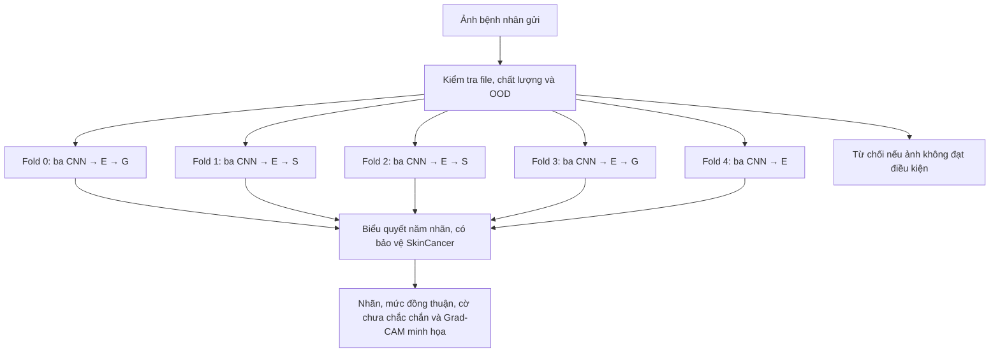

# Tổng hợp chỉ số AI để báo cáo thầy

Cập nhật ngày **11/11/2026**. Các bảng được trích từ JSON kết quả đã lưu; không huấn luyện, tính lại lựa chọn hoặc tạo kết quả thí nghiệm mới.

## 1. Bảng chính: ba model riêng và các phương án E/G/S

**Cùng 5.937 ảnh OOF, tám bệnh.** Mỗi ảnh được đánh giá bằng bộ model của fold không dùng ảnh đó để train. Đây là đánh giá phát triển; chưa phải test độc lập trên bệnh nhân mới.

| Phương án | Accuracy | Macro F1 | Recall SkinCancer |
|---|---:|---:|---:|
| EfficientNet-B0 | 72,01% | 71,00% | 78,73% |
| ConvNeXt-Tiny | 76,96% | 75,40% | 87,44% |
| ResNet50 | 74,06% | 73,16% | 81,39% |
| E — Ensemble | 78,68% | 77,24% | 88,04% |
| E + S — Ensemble và specialist | 78,69% | 77,25% | 88,04% |
| E + G — Ensemble và bộ chọn | 78,93% | 77,72% | 88,04% |
| **E/G/S — Chính sách được giữ theo fold** | 78,95% | 77,73% | 88,04% |

**Dòng báo cáo chính:** chính sách E/G/S đạt **4.687/5.937 ảnh đúng**, Accuracy **78,95%**, Macro F1 **77,73%**, Recall SkinCancer **88,04%**.

- E: kết hợp EfficientNet-B0, ConvNeXt-Tiny và ResNet50 theo quy tắc nghiên cứu.
- G: bộ chọn giữa kết quả E và ứng viên từ stacking; được giữ ở fold 0/3.
- S: đầu chuyên biệt Lupus/Psoriasis/Tinea/Eczema/Other; được giữ ở fold 1/2.
- Fold 4 dùng E. Dòng E/G/S mô tả toàn bộ chính sách theo fold, không phải bật G và S đồng loạt trong mỗi fold.
- Dòng E+S là phép bỏ G để đối chiếu với các specialist đã chọn, không phải một phương án mới được chọn lại bằng test.

**Đóng góp thêm so với E:** G tăng ròng 15 ảnh đúng; S thêm vào chính sách E+G tăng ròng một ảnh đúng (sửa 11 ảnh nhưng làm sai thêm 10 ảnh). E/G/S tăng tổng 16 ảnh đúng so với E; mức tăng còn nhỏ và chưa chứng minh cải thiện ổn định cả ba bệnh yếu.

Nguồn: [JSON ba model riêng](../ai-service/reports/original_eight_resnet50_cv_seed42/results.json), mục `results`; [JSON E/G/S](../ai-service/reports/teacher_pipeline_explanation_20261108/results.json), mục `methods`.

## 2. Chỉ số từng bệnh của bản nghiên cứu E/G/S

| Bệnh | Số ảnh | Precision | Recall | F1 |
|---|---:|---:|---:|---:|
| Acne | 663 | 84,74% | 89,59% | 87,10% |
| Candidiasis | 243 | 71,37% | 72,84% | 72,10% |
| Eczema | 1577 | 76,84% | 84,15% | 80,33% |
| Lupus | 315 | 69,93% | 61,27% | 65,31% |
| Psoriasis | 897 | 76,42% | 69,01% | 72,52% |
| SkinCancer | 677 | 86,25% | 88,04% | 87,13% |
| Tinea | 989 | 78,69% | 67,95% | 72,92% |
| Warts | 576 | 80,79% | 88,37% | 84,41% |

Nguồn: [JSON E/G/S](../ai-service/reports/teacher_pipeline_explanation_20261108/results.json), mục `methods.ensemble_gate_specialist.per_class`. Confusion matrix nằm trong `methods.ensemble_gate_specialist.confusion_matrix`.

## 3. Bản đang chạy trong đồ án: biểu quyết năm fold

API dùng lại năm bộ checkpoint và quy tắc đã chọn trong từng fold, sau đó biểu quyết có luật bảo vệ SkinCancer. Đây là bước phục vụ bổ sung; **điểm OOF ở bảng 1 không phải điểm đánh giá bước biểu quyết**. Điểm trả trên từng ảnh là mức đồng thuận, chưa phải xác suất mắc bệnh đã hiệu chỉnh.

Đánh giá hồi cứu API Docker ngày 10/11/2026, trên các tập lịch sử sau rà trùng:

| Tập đánh giá | Ảnh gửi | Trả nhãn | Từ chối | Trả đúng | Accuracy trên ảnh trả nhãn | Trả đúng / toàn bộ ảnh | Macro F1 tám lớp, tính cả từ chối |
|---|---:|---:|---:|---:|---:|---:|---:|
| Test lịch sử sau rà trùng | 486 | 420 | 66 | 341 | 81,19% | 70,16% | 71,15% |
| SCIN giữ lại sau rà trùng | 237 | 184 | 53 | 142 | 77,17% | 59,92% | 35,98% |

**Cách đọc:** trên test lịch sử, 81,19% = 341/420 ảnh được trả nhãn đúng; 70,16% = 341/486 trên toàn bộ đầu vào. Luôn báo kèm số ảnh được nhận và từ chối. Lượt chạy có một timeout được thử lại cùng ảnh, không đổi cấu hình; bảng dùng phản hồi cuối, không phải tỷ lệ thành công ngay lần đầu.

SCIN không có ảnh SkinCancer, nên không đánh giá được Recall SkinCancer trên tập đó. Chỉ có bốn ảnh Lupus, nhận đúng 0/4 (ba ảnh được trả nhãn nhưng sai, một ảnh bị từ chối). Macro F1 tám lớp của SCIN bao gồm lớp vắng; không so trực tiếp với tập đủ tám bệnh hoặc dùng điểm tổng để khẳng định từng bệnh đều tốt. SCIN đã có ảnh thuộc các ca khác trong dữ liệu phát triển, nên đây không phải nguồn hoàn toàn mới chưa từng gặp.

Nguồn: [JSON đánh giá API](../ai-service/reports/application_evaluation_20261110/results.json), mục `datasets`; [giải thích đầy đủ và confusion matrix API](../ai-service/reports/application_evaluation_20261110/summary.md).

## 4. Câu trình bày ngắn

> Dạ thầy, nhóm đã so sánh ba CNN và nghiên cứu ensemble, bộ chọn dự đoán cùng specialist. Trên cùng 5.937 ảnh OOF, chính sách được giữ đạt Accuracy 78,95%, Macro F1 77,73% và Recall SkinCancer 88,04%. Trong đó bộ chọn đóng góp tăng ròng 15 ảnh đúng so với ensemble, specialist thêm một ảnh đúng. Đồ án dùng lại năm bộ theo fold và bổ sung biểu quyết; kết quả API được đánh giá riêng, có báo số ảnh từ chối. Nhóm chưa chứng minh được cải thiện ổn định cho ba bệnh yếu trên các nguồn ảnh khác.

## 5. Đối chiếu yêu cầu mới của thầy

### 5.1. Train, validation và test có vai trò riêng

- **Train:** cập nhật trọng số CNN hoặc đầu phân loại. Augmentation chỉ tạo biến thể trong train, không tạo thêm ca độc lập.
- **Inner validation:** chọn checkpoint và quyết định thành phần nào được giữ trong từng fold.
- **Outer OOF:** mỗi ảnh được chấm bởi đúng bộ model không dùng ảnh đó để train. Tập 5.937 ảnh có năm outer fold với 1.176 / 1.193 / 1.206 / 1.201 / 1.161 ảnh. Không chạy cả năm bộ rồi lấy phiếu để tính lại OOF, vì ảnh có thể thuộc train của các bộ khác.
- **Test hồi cứu của API:** 486 ảnh nguồn cũ và 237 ảnh SCIN sau rà trùng với nguồn train được bảo vệ. Khóa danh sách trước lượt chấm API; giữ cả các ảnh bị từ chối khi báo cáo.

Các tập test hồi cứu đã được khảo sát trong lịch sử nghiên cứu, nên chưa phải test mù mới độc lập. Chia nhóm dựa trên mã ca/cảnh khi có và kiểm trùng không bảo đảm xác minh độc lập bệnh nhân cho mọi ảnh cũ.

Nguồn: [audit của đánh giá API](../ai-service/reports/application_evaluation_20261110/audit.json), [báo cáo đánh giá API](../ai-service/reports/application_evaluation_20261110/summary.md).

### 5.2. Hơn pipeline cũ ở đâu?

Trước khi so sánh phải nêu rõ “pipeline cũ” là B0 đơn hay ensemble E. Bảng sau dùng **cùng 5.937 ảnh OOF**, đơn vị **điểm phần trăm**; đây không phải so sánh trực tiếp hai API trên tập 486 ảnh.

| E/G/S được giữ so với | Chênh Accuracy | Chênh Macro F1 | Chênh Recall SkinCancer |
|---|---:|---:|---:|
| B0 đơn — baseline OOF | +6,94 | +6,73 | +9,31 |
| ConvNeXt-Tiny — model đơn tốt nhất theo Accuracy/Macro F1 | +1,99 | +2,33 | +0,59 |
| E — ensemble tham chiếu trước G/S | +0,27 | +0,49 | +0,00 |

So với model đơn tốt nhất về chỉ số tổng, kết hợp đã tăng điểm trong đánh giá OOF này. Điều đó không bảo đảm mọi bệnh và mọi nguồn đều tăng; các thử nghiệm phát triển đã lặp nhiều lần, chưa chứng minh ưu thế ổn định trên bệnh nhân mới.

### 5.3. Ablation là gì và đã có phần nào?

Ablation là giữ cùng dữ liệu đánh giá và các trọng số đã khóa, rồi bỏ từng thành phần để xem điểm thay đổi ra sao. Bốn dòng E, E+S, E+G, E/G/S trong bảng 1 là ablation đã có. Dòng E+S giữ specialist ở fold 1/2, bỏ G; không tự chọn lại phương án theo outer.

**Đã có:** ablation hồi cứu trên dự đoán OOF đã lưu. **Chưa có bảng test chung đầy đủ cho bản phục vụ:** ba model riêng, pipeline cũ và các biến thể của bản biểu quyết trên cùng tập test riêng, với quy tắc chất lượng/OOD và cách tính ảnh từ chối được quy định trước.

Đánh giá hiện có của API biểu quyết không tự chứng minh nó tốt hơn API B0 cũ. Muốn kết luận phải chấm đối chứng trên cùng danh sách ảnh. Bảng test dùng để báo cáo kết quả sau khi khóa cấu hình; nếu chọn ngưỡng hoặc chọn phương án sau khi xem test, cần một tập đánh giá giữ riêng khác.

### 5.4. Sơ đồ pipeline hiện tại

Mỗi fold trả một nhãn sau khi áp dụng quy tắc của nó; G và S không bỏ phiếu độc lập ngang hàng với CNN. Trong đánh giá OOF, chỉ dùng đúng nhánh giữ lại cho từng ảnh; bước biểu quyết nằm trong đánh giá phục vụ riêng.

## 6. Đề xuất và hiệu suất thực tế đạt được

### 6.1. Phát biểu đề xuất

**Đề xuất:** kết hợp EfficientNet-B0, ConvNeXt-Tiny và ResNet50; bổ sung bộ chọn dự đoán và specialist có điều kiện, nhằm cải thiện phân loại tám nhóm bệnh da so với mô hình riêng lẻ. Chọn các thành phần bằng inner validation và bảo toàn quyết định SkinCancer của tham chiếu. Đây là cách kết hợp các kiến trúc có sẵn; nhóm không đề xuất backbone mới.

**Kết quả đã chứng minh trong phạm vi OOF phát triển:** E/G/S được giữ có Accuracy 78,95% và Macro F1 77,73%, so với ConvNeXt đơn tốt nhất về hai chỉ số này là 76,96% và 75,40%. Chênh tương ứng **+1,99 và +2,33 điểm phần trăm**; Recall SkinCancer +0,59 điểm phần trăm. So với ensemble E, mức tăng nhỏ hơn: **+0,27 Accuracy, +0,49 Macro F1**, giữ Recall SkinCancer. Các mức chênh này đều tính trên cùng 5.937 ảnh OOF.

Đóng góp G/S được đối chiếu bằng bảng ablation ở mục 1, không suy ra rằng mỗi thành phần đều cải thiện mọi bệnh. Ngưỡng specialist 0,8 được giữ cố định trong những thí nghiệm này, chưa có cơ sở gọi là ngưỡng tối ưu.

### 6.2. Hiệu suất thực tế của bản triển khai

Chất lượng trả nhãn và tỷ lệ từ chối nằm ở mục 3. Dưới đây là thời gian HTTP đo được trong **lượt Docker CPU lịch sử ngày 10/11**, gồm xử lý API, Grad-CAM và hướng dẫn trả về. Gửi tuần tự từng ảnh; chỉ các phản hồi trả nhãn thành công được đưa vào bảng thời gian.

| Tập đánh giá | Số phản hồi trả nhãn | Trung vị thời gian | P95 thời gian |
|---|---:|---:|---:|
| Test lịch sử sau rà trùng | 420 | 0,71 giây | 0,84 giây |
| SCIN giữ lại sau rà trùng | 184 | 0,77 giây | 0,93 giây |

P95 là phân vị 95 của thời gian phản hồi quan sát được, không phải khoảng tin cậy 95% và không phải SLA. Đã có một timeout 60 giây rồi thử lại đúng ảnh trong tập test lịch sử; thời gian của lần thử thành công nằm trong bảng, lần timeout được báo riêng. Vì vậy không dùng bảng này để khẳng định mọi yêu cầu đều hoàn tất trong dưới một giây.

Nguồn thời gian: `ai-service/reports/application_evaluation_20261110/predictions.jsonl`, trường `seconds` của HTTP 200; [bằng chứng sự cố thực thi](../ai-service/reports/application_evaluation_20261110/execution_reliability.json).

**Phần chưa được chứng minh:** chưa có phép đối chứng đầy đủ về chất lượng và thời gian giữa các model riêng/pipeline cũ và biểu quyết hiện tại trên cùng tập test, cùng môi trường, cùng điều kiện tiền xử lý/OOD/Grad-CAM. Không dùng thời gian API này để khẳng định kết hợp nhanh hơn model riêng; nó chạy nhiều CNN hơn và cần được đo đối chứng. Đây cũng chưa phải kiểm thử tải đồng thời hay đánh giá lâm sàng trên bệnh nhân mới.

### 6.3. Câu kết luận được số liệu hỗ trợ

> Nhóm đề xuất phương pháp kết hợp ba CNN với cơ chế chọn dự đoán và specialist có điều kiện. Trên đánh giá OOF phát triển, phương pháp cao hơn model đơn tốt nhất 1,99 điểm phần trăm Accuracy và 2,33 điểm phần trăm Macro F1. Nhóm đã triển khai biểu quyết năm fold và báo cáo riêng chất lượng, tỷ lệ từ chối, thời gian phản hồi thực tế. Chưa kết luận bản API tốt hơn pipeline cũ về mọi mặt khi chưa có bảng test đối chứng đầy đủ.

## 7. Đối chứng mới trên test giữ riêng ở mức bộ phân loại

Đã so sánh cùng 486 ảnh nguồn cũ và 237 ảnh SCIN sau rà trùng, giữ nguyên checkpoint và quy tắc, không train/chọn lại. Tất cả ảnh nhận nhãn; **không có cổng chất lượng/OOD**, nên không thay các điểm API ở mục3. Mỗi đối chứng một kiến trúc trung bình xác suất5checkpoint; E/G/S biểu quyết5nhãn.

| Phương án | Test486 Accuracy / Macro F1 | SCIN237 Accuracy / Macro F1 tám lớp |
|---|---:|---:|
| EfficientNet-B0 · TB xác suất 5 checkpoint | 75,72% / 74,27% | 66,24% / 30,31% |
| ConvNeXt-Tiny · TB xác suất 5 checkpoint | 78,40% / 76,82% | 76,37% / 45,59% |
| ResNet50 · TB xác suất 5 checkpoint | 78,60% / 76,47% | 71,73% / 31,13% |
| E · biểu quyết 5 fold | 80,66% / 79,55% | 75,95% / 43,02% |
| E+S · biểu quyết 5 fold | 80,86% / 79,69% | 75,53% / 40,34% |
| E+G · biểu quyết 5 fold | 80,66% / 79,38% | 76,37% / 44,20% |
| E/G/S · biểu quyết 5 fold | 80,86% / 79,53% | 75,95% / 41,51% |

E/G/S cao hơn đối chứng một kiến trúc trên test nguồn cũ, nhưng chỉ tăng một ảnh so E và Macro F1 giảm nhẹ. Trên SCIN chưa vượt ConvNeXt; Lupus1/4, không có SkinCancer để tính recall. Không chọn lại cấu hình từ test, không khẳng định G/S tăng ổn định hoặc xác nhận lâm sàng. Các nguồn đã khảo sát lịch sử, chưa phải test mù bệnh nhân mới.

[Dữ liệu gốc và chỉ số từng fold/từng bệnh](../ai-service/reports/frozen_test_comparison_20261113/results.json), [giao thức và giới hạn](../ai-service/reports/frozen_test_comparison_20261113/summary.md), [kiểm chứng](../ai-service/reports/frozen_test_comparison_20261113/verification.json).
